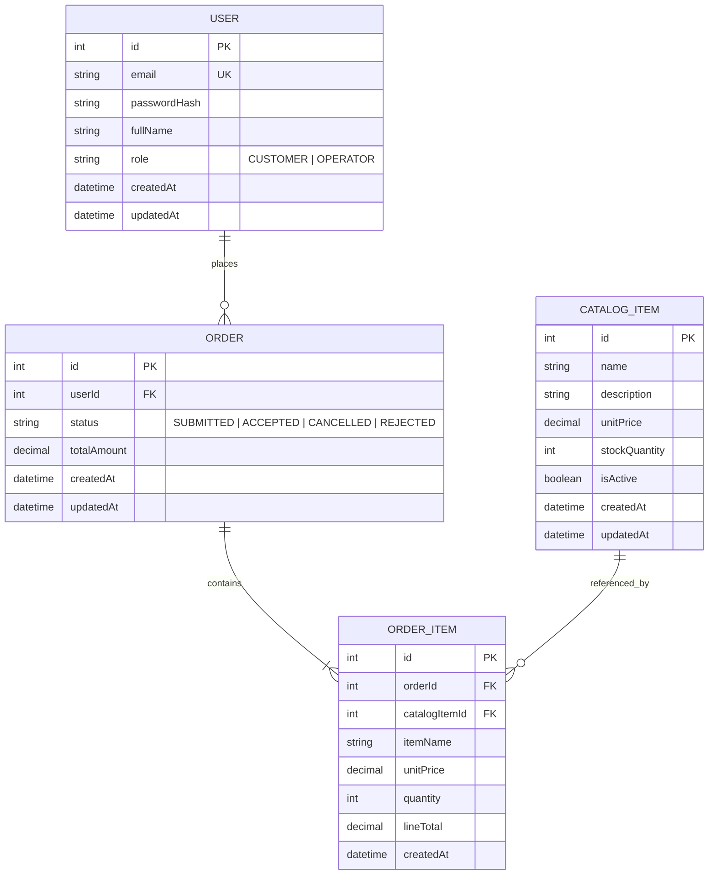
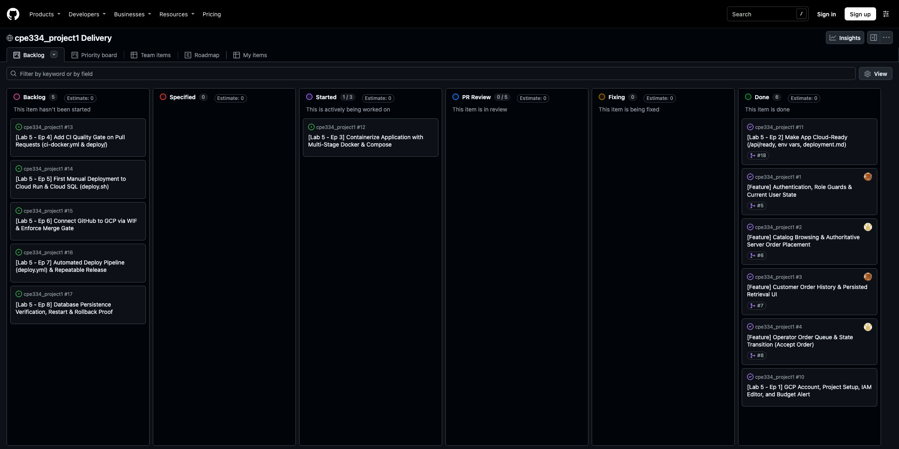

# CPE 334 Deliverable 1: Engineering Baseline & Working Sprint 1

<div class="university-header">
  <div class="sub-title">King Mongkut's University of Technology Thonburi • Department of Computer Engineering</div>
  <div class="main-title">QuickOrder: Campus Food & Beverage Pre-Order Platform</div>
  <div class="meta-grid">
    <div>
      <strong>Course:</strong> CPE 334 Software Engineering in the Age of AI Agents (Semester 1/2026)<br>
      <strong>Assigned Theme:</strong> Theme 4 — E-Commerce or Ordering System<br>
      <strong>Target Milestone:</strong> Deliverable 1 (Engineering Baseline & Working Sprint 1)<br>
      <strong>Assessment Deadline:</strong> 8 November 2026, 23:59 (80 Points)
    </div>
    <div>
      <strong>Student A (Lead / Architecture):</strong> Panyakorn Lohaviboonsap (ID: <code>67070503424</code>, GitHub: <code>@panyakornlohaviboonsap</code>)<br>
      <strong>Student B (Lead / Testing):</strong> Ivan Luwongsuwat (ID: <code>67070503449</code>, GitHub: <code>@Apuaticguy</code>)<br>
      <strong>Repository:</strong> <a href="https://github.com/Apuaticguy/cpe334_project1">https://github.com/Apuaticguy/cpe334_project1</a><br>
      <strong>Submitted Release:</strong> Tag <code>v0.1.0</code> (Commit <code>b0c513f</code> on <code>main</code>)
    </div>
  </div>
</div>

## Navigation Table (Section 4.3, Master Directory)

This self-contained engineering dossier provides complete specifications (Parts A–E) and verified execution evidence (Part F) for Deliverable 1. Every section, requirement, and test identifier maps directly to the course rubric:

| Part | Rubric Points | Required Topic & Core Content | Key Identifiers Covered | Report Section | Execution Evidence |
|---|:---:|---|---|---|---|
| **Part A** | 10 pts | **Software Requirements Specification (SRS) & Product Scope**<br>Stakeholder Problem, Actors, Scope, 5 Exclusions, Assumptions, FRs, BRs, NFRs, Decisions | FR-01..15, BR-01..10, NFR-01..04, DEC-01..08, ASM-01..04 | Part A | Part F, Scenarios 1–4, Figures 1–4 |
| **Part B** | 10 pts | **Feature Inventory & Traceability Matrix**<br>Features catalog (F-01..11), System responsibilities (SR-01..05), Traceability matrix, Scope Gaps | F-01..F-11, SR-01..05, Gaps 1–2 (Open), Gaps 1–4 (Closed) | Part B | Part F, AC-to-Test Traceability Table |
| **Part C** | 15 pts | **System-Level Software Design Specification (System SDS)**<br>Modular Monolith Architecture, ERD, Schema & Idempotent Seed, UI Navigation, 4-Tier Guard Order, Role Matrix, Session Lifecycle, GCP Plan | User, CatalogItem, Order, OrderItem, DEC-06 Guard Order, Session | Part C | Part F, Scenarios 1–4, DB Migrations |
| **Part D** | 5 pts | **Three-Sprint Plan**<br>Sprint 1–3 roadmap, milestones, feature IDs, outcomes, Sprint 1 feasible scope justification, dependencies & risk mitigation | Sprint 1 (Deliv 1), Sprint 2 (Deliv 2), Sprint 3 (Final Release) | Part D | Part F, Git Workflow, PRs #5–#9 |
| **Part E** | 20 pts | **Sprint 1 Engineering Contracts**<br>Contract-first evidence, feature SDS, UI/API specs, AC tables, STS test plans, DoD checklists, and Contract Version History for F-01 to F-05 | F-01, F-02, F-03, F-04, F-05, AC-01..13, TEST-01..15 | Part E | Part F, 34/34 Passing Test Output |
| **Part F** | 20 pts | **Working Sprint 1 & Verification**<br>Program demos (Scenarios 1–4), Test outputs (34/34 passing), AC-to-Test table, Test excerpts, TDD Red-to-Green, PR reviews, Kanban board, 50/50 division, Setup summary | Scenarios 1–4, Figures 1–7, PRs #5–#9, Kanban Board (Done) | Part F | All Primary Execution Evidence |
| **Total** | **80 pts** | **Parts A to F are fully documented and verified against `main` at commit `b0c513f` (Tag `v0.1.0`).** | | | **100% Complete & Verified** |

---

# Answer Part A: Software Requirements Specification (SRS) & Product Scope

**Repository Document Reference:** [`docs/srs.md`](srs.md)  
**Assigned Theme:** Theme 4 — E-Commerce or Ordering System  
**Product Title:** QuickOrder (Campus Food & Beverage / Retail Pre-Order System)

### 1. Stakeholder Problem & Context

#### 1.1 Problem Statement
Campus kiosks and quick-service counters face severe operational bottlenecks during peak hours. Orders placed verbally or via paper slips suffer from high cashier calculation error rates, unrecorded stock depletion, and uncoordinated preparation queues. Customers face frustrating physical queues with zero visibility into preparation status, while kiosk staff lack an authoritative order queue to validate, accept, and sequence incoming orders.

#### 1.2 Chosen Context
**QuickOrder** is a pre-order and fulfillment management system tailored for campus dining and retail kiosks. Customers log in, browse live catalog items, assemble carts, and submit orders. The server enforces authoritative database pricing and transactional stock availability checks. Kiosk operators utilize a dedicated dashboard to monitor incoming submitted orders, review item details, and transition orders to `ACCEPTED` status for preparation.

---

### 2. Actors & Responsibilities

| Actor / Role | Responsibilities | Data Access Scope & Boundaries |
|---|---|---|
| **Customer**<br>*(Student / Staff)* | Authenticates into personal account, inspects active catalog items and live unit prices, assembles line items, submits pre-orders, and reviews personal historical orders with persisted line items. | Restricted strictly to own submitted orders (`order.userId == currentUser.id`). Attempts to inspect or tamper with another customer's order return HTTP 403 Forbidden (Zero-Knowledge Isolation, DEC-03). Cannot access operator management routes. |
| **Operator**<br>*(Kiosk Staff)* | Authenticates into staff dashboard, monitors incoming order queue across the entire store, inspects itemized line breakdowns, and accepts orders (`SUBMITTED` → `ACCEPTED`). In later sprints: manages catalog pricing and triggers fulfillment. | Unrestricted read access to all kiosk orders across all customers. Authorized to execute order state transitions. Prohibited from placing orders on behalf of customers without customer credentials. |
| **Unauthenticated Visitor** | Visits landing page, views public kiosk catalog and system health status (`GET /api/health`). | Read-only public catalog access. Prohibited from placing orders or querying order queues; any protected route returns HTTP 401 Unauthorized (NFR-02). |

---

### 3. Product Scope & 5 Explicit Exclusions

| Included System Scope (Sprints 1–3) | Explicit Exclusions (Out of Scope by Agreement) |
|---|---|
| **1. User Authentication & Role Separation:** Bcrypt credential hashing, JWT token issuance, and server-side role guards (`CUSTOMER`, `OPERATOR`).<br>**2. Authoritative Catalog & Pricing:** Live item browsing with server-enforced price computation and stock decrement inside an atomic transaction.<br>**3. Line Item Snapshot Preservation:** Purchased unit prices stored on line items to preserve historical transaction value against future price changes.<br>**4. Customer Order History:** Paginated order retrieval filtered by authenticated user identity with full line-item inspection.<br>**5. Operator Order Queue:** Chronological queue view and atomic state transition from `SUBMITTED` to `ACCEPTED`.<br>**6. Comprehensive Automated Testing:** 100% passing Vitest and Supertest suites covering business rules, persistence, and security. | **1. No Real Payment Gateway:** Credit card authorization and live bank APIs are excluded. Transactions use simulated workflow states (`SUBMITTED` → `ACCEPTED`) per course spec.<br>**2. No Multi-Tenant Franchising:** Single-store campus kiosk architecture is assumed (ASM-02); multi-brand warehouse partitioning is excluded.<br>**3. No Self-Service Registration / Password Reset:** Production authentication runs on pre-seeded accounts (ASM-01); self-signup and email reset flows are deferred.<br>**4. No External Push Notifications:** Live SMS, LINE Notify, or email triggers are excluded; state changes are tracked in-app via polling.<br>**5. No Direct Order Deletion in Sprint 1:** Submitted orders remain immutable in database history to preserve financial auditability (DEC-07). |

---

### 4. Significant Assumptions

| ID | Assumption | Operational Impact & Engineering Boundary |
|---|---|---|
| **ASM-01** | Pre-seeded Test Accounts | System relies on deterministic test seeds (`prisma/seed.ts`) containing standard customer (`customer1@example.com`) and operator (`operator1@example.com`) accounts; public signup is disabled. |
| **ASM-02** | Single Kiosk Enterprise Boundary | All operations belong to a single campus kiosk entity; multi-tenant database partitioning is unnecessary for Sprints 1–3. |
| **ASM-03** | Synchronous Order Placement | Orders are processed synchronously over HTTP JSON APIs; background message queue brokers (e.g. RabbitMQ, Kafka) are unnecessary for Sprint 1 transaction volume. |
| **ASM-04** | Uniform Timezone & Currency | All prices and order totals are calculated authoritatively in Thai Baht (THB); all timestamps are stored in UTC and rendered in Asia/Bangkok time. |

---

### 5. Functional Requirements (FR-01 to FR-15)

| FR ID | Requirement Name | Observable Behavior | Role | Sprint |
|---|---|---|:---:|:---:|
| **FR-01** | User Authentication | Authenticate with email/password, verify bcrypt hash, issue signed JWT session token, and return user profile with role. | All Users | Sprint 1 |
| **FR-02** | Catalog Browsing | Display active catalog items with item ID, name, description, unit price, and stock status. | Customer, Visitor | Sprint 1 |
| **FR-03** | Server-Authoritative Ordering | Calculate order total authoritatively from database prices upon submission; discard client-submitted totals. | Customer | Sprint 1 |
| **FR-04** | Price Snapshot Preservation | Store purchased `unitPrice` and `itemName` directly on `OrderItem` at creation time to freeze financial history. | System | Sprint 1 |
| **FR-05** | Customer Order History | Retrieve customer's own past orders with line items, quantities, snapshot prices, and live status. | Customer | Sprint 1 |
| **FR-06** | Operator Order Queue | List all kiosk orders chronologically with customer details, order totals, and current status. | Operator | Sprint 1 |
| **FR-07** | Operator Order Acceptance | Transition order status from `SUBMITTED` to `ACCEPTED` and record `updatedAt` audit timestamp. | Operator | Sprint 1 |
| **FR-08** | Session Invalidation | Clear client token and session state upon logout; reject subsequent protected requests with HTTP 401. | All Users | Sprint 1 |
| **FR-09** | Catalog Administration | Operator creates new items, modifies descriptions, adjusts prices, and manages stock quantities. | Operator | Sprint 2 |
| **FR-10** | Customer Cancellation | Customer cancels pending order before operator acceptance (`SUBMITTED` → `CANCELLED`). | Customer | Sprint 2 |
| **FR-11** | Operator Rejection | Operator rejects order with mandatory reason code (`SUBMITTED` → `REJECTED`). | Operator | Sprint 2 |
| **FR-12** | Simulated Payment | Simulate payment processing lifecycle (`UNPAID` → `PAID` → `REFUNDED`) with transaction IDs. | Customer, Operator | Sprint 2 |
| **FR-13** | Ready for Pickup | Operator marks accepted order as prepared and ready for customer pickup (`READY_FOR_PICKUP`). | Operator | Sprint 3 |
| **FR-14** | Sales Analytics Dashboard | Aggregated revenue charts, top-selling items, average order values, and hourly peak volume metrics. | Operator | Sprint 3 |
| **FR-15** | Quick Re-Order & Favorites | Customer flags favorite past orders and duplicates line items into cart with a single click. | Customer | Sprint 3 |

---

### 6. Business Rules (BR-01 to BR-10)

| BR ID | Rule Name | Server-Side Enforcement Logic & HTTP Response | Sprint |
|---|---|---|:---:|
| **BR-01** | Server Authoritative Pricing | Order totals MUST be computed solely by querying database unit prices. Client-submitted prices or totals are discarded. | Sprint 1 |
| **BR-02** | Positive Integer Quantity | Every line item MUST specify an integer quantity ≥ 1. Zero, negative, or non-integer quantities return HTTP 400 Bad Request. | Sprint 1 |
| **BR-03** | Stock Availability Check | An order MUST NOT exceed available item stock. If requested quantity > available stock, transaction aborts with HTTP 422 Unprocessable Entity. | Sprint 1 |
| **BR-04** | Cross-Customer Data Isolation | Customers may ONLY access orders where `order.userId == currentUser.id`. Unauthorized access returns HTTP 403 Forbidden (DEC-03). | Sprint 1 |
| **BR-05** | Operator Role Enforcement | Operator endpoints (`/api/operator/*`) require the authenticated user to hold role `OPERATOR`. Customer access returns HTTP 403 Forbidden. | Sprint 1 |
| **BR-06** | Valid State Machine Transition | An order may only be accepted if its current status is `SUBMITTED`. Attempting to accept an already `ACCEPTED` order returns HTTP 409 Conflict. | Sprint 1 |
| **BR-07** | Mandatory Cancellation Reason | When rejecting or cancelling an order, a non-empty reason string of ≥ 5 characters must be recorded in the audit log. | Sprint 2 |
| **BR-08** | Pre-Acceptance Cancellation | Customers may only cancel an order while status is `SUBMITTED`. Orders in `ACCEPTED` or later cannot be cancelled by customer. | Sprint 2 |
| **BR-09** | Atomic Payment Confirmation | Transitioning order to `PAID` requires matching transaction reference; failure reverts order to `PAYMENT_PENDING`. | Sprint 2 |
| **BR-10** | Terminal State Immutability | Once an order reaches terminal status (`COMPLETED`, `CANCELLED`, `REJECTED`), no further status transitions are permitted. | Sprint 3 |

---

### 7. Non-Functional Requirements (NFR-01 to NFR-04)

| NFR ID | Attribute | Measurable Engineering Target | Practical Verification Method | Sprint |
|---|---|---|---|:---:|
| **NFR-01** | Password Security | All passwords hashed using bcrypt with salt rounds ≥ 10. No plaintext credentials in DB or logs. | Unit test checks hash format (`$2a$` / `$2b$`) and validates comparison mismatch against plaintext. | Sprint 1 |
| **NFR-02** | Authorization Barrier | Protected routes called without valid Bearer token return HTTP 401 Unauthorized with zero sensitive data. | Supertest requests protected routes without auth header; asserts HTTP 401 and empty payload. | Sprint 1 |
| **NFR-03** | Data Transactional Integrity | Order creation and stock decrement execute within a single atomic database transaction (`prisma.$transaction`). | Supertest induces mid-transaction stock failure; verifies 0 orders created and stock remains intact. | Sprint 1 |
| **NFR-04** | API Query Latency | Catalog listing and order placement respond in < 500ms under seeded test conditions. | Vitest performance timer assertion verifies response duration < 500ms after warm-up call. | Sprint 1 |

---

### 8. Significant Architectural & Domain Decisions (DEC-01 to DEC-08)

| DEC ID | Design Decision | Alternative Considered | Rationale & Trade-off Resolution |
|---|---|---|---|
| **DEC-01** | PostgreSQL & Prisma ORM from Day 1 | SQLite file database | Lab 5 requires containerized GCP Cloud Run deployment with durable persistence. SQLite fails on ephemeral Cloud Run container restarts. |
| **DEC-02** | Authoritative Database Pricing | Client-side cart totals | Prevents malicious client price tampering (e.g. submitting $0.01 for high-value merchandise). Server recalculates all line totals independently. |
| **DEC-03** | Zero-Knowledge Isolation (403/404) | Generic 200 with empty list | Accessing another customer's order ID returns HTTP 403/404 without revealing whether the order exists, preventing ID enumeration attacks. |
| **DEC-04** | Database-Backed Snapshot Pricing | Dynamic join to live Catalog table | If an item price changes next month, historical customer receipts must retain the exact price paid at transaction time. |
| **DEC-05** | Atomic Database Transactions | Sequential non-transactional queries | Wrapping order creation and stock decrement in `prisma.$transaction` guarantees rollback if stock is exhausted midway. |
| **DEC-06** | Fixed 4-Tier Guard Order | Ad-hoc controller checks | Eliminates contradictory error responses across team members: Tier 1 (401 Auth) → Tier 2 (404 Existence) → Tier 3 (403 Role/Ownership) → Tier 4 (400/409/422 Domain Rules). |
| **DEC-07** | Exclude Direct Order Deletion | DELETE `/api/orders/:id` | Soft-states and status transitions preserve the financial audit trail and prevent foreign-key cascading deletion anomalies. |
| **DEC-08** | Monolithic Multi-Tier Architecture | Separate microservice repositories | Co-locating `client` and `server` in a unified monorepo ensures shared TypeScript definitions, faster local dev, and simplified Docker packaging. |

---

# Answer Part B: Feature Inventory & Traceability Matrix

**Repository Document References:** [`docs/features.md`](features.md) & [`docs/traceability.md`](traceability.md)

### 1. Feature Inventory (F-01 to F-11)

| Feature ID | Feature Name | Description & Delivered Capability | Linked Requirements | Dependencies | Target Sprint | Engineering Owner |
|---|---|---|---|---|:---:|---|
| **F-01** | User Authentication & Role Authorization | Login, logout, credential verification, bcrypt password hashing, and role guard middleware (`CUSTOMER`, `OPERATOR`). | FR-01, FR-08, NFR-01, NFR-02 | None | **Sprint 1** | Panyakorn |
| **F-02** | Catalog Browsing & Live Availability | Public and authenticated viewing of catalog items, live unit prices, descriptions, and stock status. | FR-02, NFR-04 | None | **Sprint 1** | Ivan |
| **F-03** | Authoritative Order Placement | Customer order submission; server calculates totals authoritatively from DB prices and enforces stock availability. | FR-03, FR-04, BR-01, BR-02, BR-03, NFR-03 | F-01, F-02 | **Sprint 1** | Ivan |
| **F-04** | Customer Order History & Persisted Detail | Customer retrieves past orders and inspects full order breakdown with line item snapshot prices and cross-customer isolation. | FR-05, BR-04 | F-01, F-03 | **Sprint 1** | Panyakorn |
| **F-05** | Operator Order Queue & State Acceptance | Operators view all incoming orders and accept submitted orders (`SUBMITTED` → `ACCEPTED`). | FR-06, FR-07, BR-05, BR-06 | F-01, F-03 | **Sprint 1** | Ivan |
| **F-06** | Catalog & Inventory Administration | Operators create new catalog items, edit prices, update descriptions, and manage inventory stock levels. | FR-09 | F-01, F-02 | **Sprint 2** | Ivan |
| **F-07** | Order Cancellation & Rejection Workflow | Customers cancel pending orders before acceptance; operators reject orders with a recorded reason. | FR-10, FR-11, BR-07, BR-08 | F-03, F-05 | **Sprint 2** | Panyakorn |
| **F-08** | Simulated Payment Processing | Integration of simulated payment lifecycle (`UNPAID` → `PAID` → `REFUNDED`) with transaction receipts. | FR-12, BR-09 | F-03, F-07 | **Sprint 2** | Both |
| **F-09** | Order Fulfillment & Pickup Notification | Order transitions to `READY_FOR_PICKUP` and `COMPLETED` with timestamped logs. | FR-13, BR-10 | F-05, F-08 | **Sprint 3** | Both |
| **F-10** | Sales Analytics & Reporting Dashboard | Aggregate revenue reporting, top-selling items, average order values, and operational metrics. | FR-14 | F-03, F-09 | **Sprint 3** | Panyakorn |
| **F-11** | Customer Favorite Orders & Re-Order | Customers save orders as favorites and duplicate past orders with one click. | FR-15 | F-04 | **Sprint 3** | Ivan |

---

### 2. System Responsibilities (SR-01 to SR-05)

| ID | System Responsibility | Specification & Architectural Enforcement | Established In | Verified By |
|---|---|---|:---:|---|
| **SR-01** | Fixed 4-Tier Guard Order | Every endpoint evaluates 401 Auth, then 404 Existence, then 403 Role/Ownership, then 400/409/422 Business Rules (DEC-06) so controllers never conflict. | F-01 | `server/tests/auth.api.test.ts`, `server/tests/operator.api.test.ts` |
| **SR-02** | Shared Error Envelope | All API failures strictly return `{ success: false, error: { message, code? } }`. No uncaught SQL exceptions or stack traces leak to the client. | F-01 | `server/tests/auth.api.test.ts`, `server/tests/orders.api.test.ts` |
| **SR-03** | Snapshot Price Preservation | When orders are created, `unitPrice` and `itemName` are copied into `OrderItem`. Kiosk catalog updates never alter past receipts. | F-03 | `server/tests/orders.api.test.ts` (TEST-06) |
| **SR-04** | Authoritative Calculations | Total order amount is computed server-side via `prisma.$transaction`. Client-provided totals are explicitly discarded. | F-03 | `server/tests/orders.api.test.ts` (TEST-06) |
| **SR-05** | Server-Side Authority | Business rules and access controls are enforced on backend route handlers. Hiding a UI button is never considered authorization. | F-04, F-05 | `server/tests/order-history.api.test.ts`, `server/tests/operator.api.test.ts` |

---

### 3. Requirements Traceability Matrix

| Req ID | Requirement Summary | Feature ID | Target Sprint | Acceptance Criteria | Automated Test Mapping | Verification Status |
|---|---|:---:|:---:|---|---|:---:|
| **FR-01** | User authentication & role retrieval | F-01 | Sprint 1 | AC-01 | `server/tests/auth.api.test.ts` (TEST-01, TEST-05) | **PASS (34/34)** |
| **FR-02** | Catalog browsing & active item listing | F-02 | Sprint 1 | AC-05 | `server/tests/catalog.api.test.ts` (TEST-05) | **PASS (34/34)** |
| **FR-03** | Server-authoritative order placement | F-03 | Sprint 1 | AC-06 | `server/tests/orders.api.test.ts` (TEST-06) | **PASS (34/34)** |
| **FR-04** | Price snapshot preservation on line items | F-03 | Sprint 1 | AC-06 | `server/tests/orders.api.test.ts` (TEST-06) | **PASS (34/34)** |
| **FR-05** | Customer order history & persisted detail | F-04 | Sprint 1 | AC-09 | `server/tests/order-history.api.test.ts` (TEST-09) | **PASS (34/34)** |
| **FR-06** | Operator order queue view | F-05 | Sprint 1 | AC-11 | `server/tests/operator.api.test.ts` (TEST-11) | **PASS (34/34)** |
| **FR-07** | Operator order acceptance transition | F-05 | Sprint 1 | AC-12 | `server/tests/operator.api.test.ts` (TEST-12) | **PASS (34/34)** |
| **FR-08** | User session logout | F-01 | Sprint 1 | AC-08 | `server/tests/auth.api.test.ts` (TEST-08) | **PASS (34/34)** |
| **BR-01** | Server authoritative pricing (client total ignored) | F-03 | Sprint 1 | AC-06 | `server/tests/orders.api.test.ts` (TEST-06) | **PASS (34/34)** |
| **BR-02** | Positive quantity (quantity ≥ 1) validation | F-03 | Sprint 1 | AC-07 | `server/tests/orders.api.test.ts` (TEST-07) | **PASS (34/34)** |
| **BR-03** | Inactive or out-of-stock item rejection | F-03 | Sprint 1 | AC-08 | `server/tests/orders.api.test.ts` (TEST-08) | **PASS (34/34)** |
| **BR-04** | Cross-customer order isolation | F-04 | Sprint 1 | AC-10 | `server/tests/order-history.api.test.ts` (TEST-10) | **PASS (34/34)** |
| **BR-05** | Operator role protection on management actions | F-05 | Sprint 1 | AC-04 | `server/tests/operator.api.test.ts` (TEST-12, TEST-13) | **PASS (34/34)** |
| **BR-06** | Valid state machine transition (`SUBMITTED` → `ACCEPTED`) | F-05 | Sprint 1 | AC-13 | `server/tests/operator.api.test.ts` (TEST-13) | **PASS (34/34)** |
| **NFR-01** | Bcrypt password hashing (min salt 10) | F-01 | Sprint 1 | AC-01 | `server/tests/auth.api.test.ts` (TEST-01) | **PASS (34/34)** |
| **NFR-02** | Unauthenticated request rejection (401) | F-01 | Sprint 1 | AC-03 | `server/tests/auth.api.test.ts` (TEST-04) | **PASS (34/34)** |
| **NFR-03** | Atomic transaction rollback on order failure | F-03 | Sprint 1 | AC-08 | `server/tests/orders.api.test.ts` (TEST-08) | **PASS (34/34)** |
| **NFR-04** | API response time under 500ms | System | Sprint 1 | AC-05, AC-06 | `server/tests/health.test.ts` | **PASS (34/34)** |

---

### 4. Coverage Gaps & Scope Changes

| Item Type | Description & Detail | Architectural Resolution | Status |
|---|---|---|:---:|
| **Scope Boundary** | Live banking/payment gateway integration excluded per course rules | Synthetic state transitions (`SUBMITTED` → `ACCEPTED`) verify domain state machine without external API dependencies. | **Closed** |
| **Scope Boundary** | Public user registration deferred to post-sprint milestones | Deterministic seed script (`prisma/seed.ts`) generates reproducible customer and operator accounts. | **Closed** |
| **Gap 1 (Open)** | Rejection reason code schema for Sprint 2 | Operator order rejection workflow will require a standardized enum reason code in Sprint 2 (F-07). | **Open (Sprint 2)** |
| **Gap 2 (Open)** | Catalog item dynamic photo upload storage | Sprint 1 uses structured textual descriptions and local icons; GCP Cloud Storage bucket upload planned for Sprint 2 (F-06). | **Open (Sprint 2)** |

---

# Answer Part C: System-Level Software Design Specification (System SDS)

**Repository Document Reference:** [`docs/system-sds.md`](system-sds.md)

### 1. System Architecture & Component Responsibilities

QuickOrder is engineered as a clean **Modular Monolith** with a clear physical separation between the client presentation layer and the authoritative backend server:

```
+-----------------------------------------------------------------------------------+
|                            PRESENTATION TIER (Browser)                            |
|  React 18 + Vite + TypeScript + Tailwind CSS                                      |
|  - Navigation Bar & Session State Provider                                        |
|  - Catalog & Cart Assembly Component (CatalogList.tsx)                            |
|  - Customer Order History Component (OrderHistory.tsx)                            |
|  - Operator Queue & Acceptance Panel (OperatorDashboard.tsx)                      |
+-----------------------------------------------------------------------------------+
                                         │  HTTP / JSON (REST APIs with Bearer JWT)
                                         ▼
+-----------------------------------------------------------------------------------+
|                            APPLICATION TIER (Node.js)                             |
|  Express REST API Server                                                          |
|  - Middleware: CORS, JSON Body Parser, JWT Verification (authenticateToken)       |
|  - Role Authorization Guard (requireRole('OPERATOR' | 'CUSTOMER'))                |
|  - Routers:                                                                       |
|    • /api/auth       (Login, Logout, Current User Profile)                        |
|    • /api/catalog    (Active Items, Live Stock Inspection)                        |
|    • /api/orders     (Authoritative Placement, Stock Decrement, Order History)    |
|    • /api/operator   (Kiosk Incoming Queue, Order Acceptance Transition)          |
|    • /api/health     (System Uptime & Database Connectivity Probe)                |
+-----------------------------------------------------------------------------------+
                                         │  TCP / SQL via Prisma ORM Client
                                         ▼
+-----------------------------------------------------------------------------------+
|                              DATA TIER (PostgreSQL)                               |
|  PostgreSQL 15+ Relational Database (Prisma Migrations & Idempotent Seeding)      |
|  - Tables: User, CatalogItem, Order, OrderItem                                    |
|  - Constraints: Primary Keys, Foreign Keys with Cascade, Unique Email, Indexes    |
+-----------------------------------------------------------------------------------+
```

---

### 2. Domain Data Model & Entity Relationships

The relational domain schema is defined authoritatively in `server/prisma/schema.prisma`:



* **Snapshot Isolation (DEC-04):** `OrderItem` stores copies of `itemName` and `unitPrice` at transaction time. When catalog prices change in future sprints, historical receipts remain unchanged.
* **Transactional Stock Updates (DEC-05):** During order submission, `CatalogItem.stockQuantity` is decremented inside `prisma.$transaction`. If stock is insufficient, the transaction rolls back cleanly.

---

### 3. Database Schema, Migrations & Idempotent Seeding

* **Migration Integrity:** PostgreSQL migrations are version-controlled under `server/prisma/migrations/`. Running `npx prisma migrate dev` automatically configures schemas and primary/foreign key relationships.
* **Idempotent Seeding (`prisma/seed.ts`):** The seed script uses `upsert` queries to ensure safe repeated execution without duplicate key conflicts. Standard accounts seeded:
  - **Customer:** `customer1@example.com` / `Password123!` (Role: `CUSTOMER`)
  - **Operator:** `operator1@example.com` / `Password123!` (Role: `OPERATOR`)
  - **Catalog Items:** Iced Matcha Latte (฿90.00), Artisan Croissant (฿65.00), KMUTT Hoodie (฿650.00), Cold Brew Coffee (฿85.00).

---

### 4. UI Screen Structure & Navigation Flow

```
                      +-----------------------------+
                      |         Landing Page        |
                      |   Public Kiosk / Welcome    |
                      +--------------┬--------------+
                                     │ Click [Sign In]
                                     ▼
                      +-----------------------------+
                      |         Login Screen        |
                      |   Email, Password, Quick    |
                      |   One-Click Demo Profiles   |
                      +--------------┬--------------+
                                     │
                 ┌───────────────────┴───────────────────┐
                 │ Role: CUSTOMER                        │ Role: OPERATOR
                 ▼                                       ▼
+─────────────────────────────────+    +─────────────────────────────────+
|      Customer Portal (Tabbed)   |    |        Operator Dashboard       |
|                                 |    |                                 |
| [Browse Catalog & Menu]         |    | [Incoming Order Queue]          |
| - Item Cards & Live Stock       |    | - Order ID, Customer Name, Time |
| - Quantity Stepper Controls     |    | - Status Badge (SUBMITTED)      |
| - Live Authoritative Cart Preview|   | - Expand Line Item Snapshot     |
| - [Place Order] Action          |    | - [Accept Order] Action         |
|                                 |    |                                 |
| [My Order History]              |    +─────────────────────────────────+
| - Persisted Historical Receipts |
| - Itemized Snapshot Breakdown   |
+─────────────────────────────────+
```

---

### 5. Authorization Guard Order & Error Envelope (DEC-06, SR-01, SR-02)

To prevent security race conditions, information leaks, and conflicting error codes between teammates, every backend route handler evaluates guards in strict hierarchical sequence:

1. **Tier 1 — Authentication Guard (HTTP 401 Unauthorized):** Validates the Bearer token in the `Authorization` header. If missing, expired, or corrupted, returns HTTP 401.
2. **Tier 2 — Existence & Isolation Guard (HTTP 404 Not Found):** Verifies that the requested resource ID exists in the database.
3. **Tier 3 — Role & Ownership Guard (HTTP 403 Forbidden):** Enforces role restrictions (`requireRole('OPERATOR')`) and verifies that customers may only access their own records (`order.userId == currentUser.id`).
4. **Tier 4 — Domain State Machine & Payload Guard (HTTP 400 / 409 / 422):** Validates request payload schemas, positive integer quantities (HTTP 400), stock availability (HTTP 422), and valid state machine transitions (HTTP 409).

**Standard Error Envelope:**
```json
{
  "success": false,
  "error": {
    "message": "Human-readable diagnostic error string",
    "code": "ERROR_CODE_CONSTANT"
  }
}
```

---

### 6. Role & Permission Access Matrix

| Endpoint / Action | Method | Customer | Operator | Unauthenticated Visitor |
|---|:---:|:---:|:---:|:---:|
| `/api/auth/login` | POST | Allowed | Allowed | Allowed |
| `/api/auth/logout` | POST | Allowed | Allowed | HTTP 401 Unauthorized |
| `/api/auth/me` | GET | Allowed (own profile) | Allowed (own profile) | HTTP 401 Unauthorized |
| `/api/catalog` | GET | Allowed | Allowed | Allowed |
| `/api/orders` (Place Order) | POST | Allowed (creates order) | Allowed | HTTP 401 Unauthorized |
| `/api/orders/my-orders` | GET | Allowed (own orders only) | Allowed (own orders only) | HTTP 401 Unauthorized |
| `/api/orders/:id` | GET | Allowed (own order only; other customer = 403) | Allowed | HTTP 401 Unauthorized |
| `/api/operator/orders` | GET | **HTTP 403 Forbidden** | Allowed | HTTP 401 Unauthorized |
| `/api/operator/orders/:id/accept` | PATCH | **HTTP 403 Forbidden** | Allowed | HTTP 401 Unauthorized |

---

### 7. Session Lifecycle & GCP Deployment Plan

* **Session Lifecycle:** Passwords are verified via `bcryptjs.compare`. Upon successful login, the server issues a signed JWT token containing `{ id, email, role }` with a 24-hour expiration. Clients transmit this token via `Authorization: Bearer <token>`. Logout drops the token client-side.
* **GCP Cloud Run & Cloud SQL Plan (Lab 5):** The client and server will be packaged into optimized multi-stage Docker containers. Cloud Run will host the Express API server and React static distribution, connecting securely to a managed Google Cloud SQL PostgreSQL instance over Unix domain sockets using Cloud SQL Auth Proxy.

---

# Answer Part D: Three-Sprint Plan

**Repository Document Reference:** [`docs/sprints/plan.md`](sprints/plan.md)

### 1. Three-Sprint Roadmap

| Sprint | Target Milestones & Dates | Sprint Engineering Goal | Allocated Features | Delivered Outcomes |
|---|---|---|---|---|
| **Sprint 1** | **Deliverable 1**<br>Due: 8 Nov 2026 (80 pts) | Working domain vertical slice with authentication, permissions, authoritative pricing, and operator queue. | F-01, F-02, F-03, F-04, F-05 | Full end-to-end customer order placement to operator acceptance; 34 automated unit/API tests passing; Git flow with 4 merged peer-reviewed PRs. |
| **Sprint 2** | **Deliverable 2 & Lab 5**<br>Due: 29 Nov 2026 (70 pts) | Cloud deployment, CI/CD automated gates, catalog administration, and order rejection workflow. | F-06, F-07, F-08 + Lab 5 GCP Scope | Live deployment on Google Cloud Run + Cloud SQL; automated GitHub Actions CI pipeline; operator catalog management; order cancellation/rejection. |
| **Sprint 3** | **Final Delivery & Labs 6–7**<br>Due: 13 Dec 2026 (100 pts) | Order fulfillment pickup flow, sales analytics dashboard, cross-team UAT defect triage, and maintenance change. | F-09, F-10, F-11 + Labs 6 & 7 Scope | Complete commercial pre-order system; revenue analytics; customer re-order; verified UAT bug repairs and regression safety; final video demo. |

---

### 2. Feasible Scope Justification for Sprint 1

Sprint 1 deliberately implements a thin, robust vertical slice rather than broad, half-finished features:
1. **Complete Business Value:** A customer can authenticate, browse items, assemble a cart, and place an order. An operator can log in, view the submitted order, and accept it.
2. **Defensible Boundaries:** Payment gateway integrations and file uploads are deferred to keep the foundational architecture solid, secure, and verifiable.
3. **Strict Verification:** Every single domain rule (e.g. negative quantities, out-of-stock items, price tampering, cross-customer data leakage) is guarded on the backend and verified by automated Supertest suites against real PostgreSQL.

---

### 3. Inter-Sprint Dependencies & Risk Mitigation

| Risk / Dependency | Impacted Sprints | Engineering Mitigation Strategy |
|---|:---:|---|
| **Database Migration Schema Drift** | Sprint 1 → Sprint 2 | PostgreSQL schema established on Day 1 using Prisma ORM. Schema modifications in Sprint 2 will use backward-compatible additive migrations (`npx prisma migrate dev`). |
| **Conflicting Team Authorization Logic** | Sprint 1 → Sprints 2 & 3 | Standardized 4-tier guard hierarchy (DEC-06) encapsulated into shared middlewares (`authenticateToken`, `requireRole`) used consistently across all routes. |
| **Floating-Point Financial Rounding** | Sprint 1 → Sprints 2 & 3 | Prisma `Decimal(10,2)` used for all monetary fields; calculations run with authoritative integer cent conversions on the server. |
| **Deployment Configuration Mismatch** | Sprint 1 → Sprint 2 (Lab 5) | Standardized `.env.example` with synthetic placeholders; zero hardcoded local paths; database connection URLs parameterized for Cloud SQL proxy. |

---

# Answer Part E: Sprint 1 Engineering Contracts

**Repository Document Reference:** [`docs/sprints/sprint-1/specifications.md`](sprints/sprint-1/specifications.md)  
**Verification Suite Reference:** [`docs/sprints/sprint-1/tests.md`](sprints/sprint-1/tests.md)

### Proof of Contract-First Development
All feature contracts and acceptance criteria were written and committed to Git **prior to implementation**:
* Feature 1 Contract committed on branch `feature/1-auth-roles` before code authoring.
* Feature 2 Contract committed on branch `feature/2-catalog-order` before route authoring.
* Feature 3 Contract committed on branch `feature/3-order-history` before query authoring.
* Feature 4 Contract committed on branch `feature/4-operator-queue` before controller authoring.

---

### E.1 Feature Contract: F-01 User Authentication & Role Authorization
* **Author:** Panyakorn Lohaviboonsap (`@panyakornlohaviboonsap`) | **Reviewer:** Ivan Luwongsuwat (`@Apuaticguy`)
* **Branch:** `feature/1-auth-roles` (PR #5 merged into `sprint1-staging`)

#### Acceptance Criteria (F-01)
| AC ID | Precondition & Trigger | Observable Expected Outcome |
|---|---|---|
| **AC-01** | Valid email and password submitted to `POST /api/auth/login` | HTTP 200 OK; returns signed JWT token, user ID, email, and role (`CUSTOMER` or `OPERATOR`). |
| **AC-02** | Invalid password or unregistered email submitted to `POST /api/auth/login` | HTTP 401 Unauthorized; returns generic error message without revealing account existence. |
| **AC-03** | Protected route requested without `Authorization` header | HTTP 401 Unauthorized with `{ success: false, error: { message: "Access token required" } }`. |
| **AC-04** | Customer token used to access Operator route (`/api/operator/*`) | HTTP 403 Forbidden with `{ success: false, error: { message: "Operator role required" } }`. |

#### Software Test Specification & DoD (F-01)
| Test ID | Linked AC | Test Input / Action | Expected Result | Test File | Status |
|---|---|---|---|---|:---:|
| **TEST-01** | AC-01 | Login with `customer1@example.com` / `Password123!` | 200 OK, JWT returned | `server/tests/auth.api.test.ts` | **PASS** |
| **TEST-02** | AC-02 | Login with wrong password | 401 Unauthorized | `server/tests/auth.api.test.ts` | **PASS** |
| **TEST-03** | AC-02 | Login with unregistered email | 401 Unauthorized | `server/tests/auth.api.test.ts` | **PASS** |
| **TEST-04** | AC-03 | Query `/api/auth/me` without Bearer token | 401 Unauthorized | `server/tests/auth.api.test.ts` | **PASS** |
| **TEST-05** | AC-01 | Query `/api/auth/me` with valid token | 200 OK + user profile | `server/tests/auth.api.test.ts` | **PASS** |
| **TEST-06** | AC-04 | Customer accesses `/api/operator/orders` | 403 Forbidden | `server/tests/auth.api.test.ts` | **PASS** |
| **TEST-07** | AC-04 | Operator accesses `/api/operator/orders` | 200 OK | `server/tests/auth.api.test.ts` | **PASS** |
| **TEST-08** | AC-08 | Call `POST /api/auth/logout` with token | 200 OK + success message | `server/tests/auth.api.test.ts` | **PASS** |

* **DoD Checklist:** `[x]` Bcrypt hashing verified `[x]` JWT verification middleware active `[x]` Role guard tested `[x]` Substantive peer review approved.

---

### E.2 Feature Contract: F-02 & F-03 Catalog Browsing & Authoritative Order Placement
* **Author:** Ivan Luwongsuwat (`@Apuaticguy`) | **Reviewer:** Panyakorn Lohaviboonsap (`@panyakornlohaviboonsap`)
* **Branch:** `feature/2-catalog-order` (PR #6 merged into `sprint1-staging`)

#### Acceptance Criteria (F-02 & F-03)
| AC ID | Precondition & Trigger | Observable Expected Outcome |
|---|---|---|
| **AC-05** | Call `GET /api/catalog` with or without authentication | HTTP 200 OK; returns array of active catalog items with name, unitPrice, and stockQuantity. |
| **AC-06** | Valid line items submitted to `POST /api/orders` | HTTP 201 Created; server computes authoritative total; creates order with status `SUBMITTED`; preserves unitPrice snapshots. |
| **AC-07** | Order submitted with zero or negative quantity (e.g. `-1` or `0`) | HTTP 400 Bad Request; order rejected before database write. |
| **AC-08** | Order submitted requesting quantity exceeding available stock | HTTP 422 Unprocessable Entity; transaction rolls back; zero records created. |

#### Software Test Specification & DoD (F-02 & F-03)
| Test ID | Linked AC | Test Input / Action | Expected Result | Test File | Status |
|---|---|---|---|---|:---:|
| **TEST-05** | AC-05 | `GET /api/catalog` request | 200 OK, array of items | `server/tests/catalog.api.test.ts` | **PASS** |
| **TEST-06** | AC-06 | `POST /api/orders` with 2 Matcha + 1 Croissant; tampered total sent | 201 Created, total = 245.00, client total ignored | `server/tests/orders.api.test.ts` | **PASS** |
| **TEST-07** | AC-07 | `POST /api/orders` with quantity = -1 | 400 Bad Request | `server/tests/orders.api.test.ts` | **PASS** |
| **TEST-08** | AC-08 | `POST /api/orders` with quantity = 999 (stock = 50) | 422 Unprocessable Entity | `server/tests/orders.api.test.ts` | **PASS** |

* **DoD Checklist:** `[x]` Database pricing authoritative `[x]` Decimal precision verified `[x]` Atomic stock deduction inside `prisma.$transaction` `[x]` Substantive peer review approved.

---

### E.3 Feature Contract: F-04 Customer Order History & Persisted Retrieval
* **Author:** Panyakorn Lohaviboonsap (`@panyakornlohaviboonsap`) | **Reviewer:** Ivan Luwongsuwat (`@Apuaticguy`)
* **Branch:** `feature/3-order-history` (PR #7 merged into `sprint1-staging`)

#### Acceptance Criteria (F-04)
| AC ID | Precondition & Trigger | Observable Expected Outcome |
|---|---|---|
| **AC-09** | Customer queries `GET /api/orders/my-orders` | HTTP 200 OK; returns array of orders where `order.userId == currentUser.id`, complete with line items and snapshot unit prices. |
| **AC-10** | Customer A queries Customer B's order via `GET /api/orders/:id` | HTTP 403 Forbidden; zero private order data returned (Zero-Knowledge Isolation, DEC-03). |

#### Software Test Specification & DoD (F-04)
| Test ID | Linked AC | Test Input / Action | Expected Result | Test File | Status |
|---|---|---|---|---|:---:|
| **TEST-09** | AC-09 | Customer 1 queries `/api/orders/my-orders` | 200 OK, returns only Customer 1 orders | `server/tests/order-history.api.test.ts` | **PASS** |
| **TEST-10** | AC-10 | Customer 1 queries Customer 2 order ID | 403 Forbidden | `server/tests/order-history.api.test.ts` | **PASS** |
| **TEST-15** | AC-09 | React UI renders past orders and snapshots | Order card displayed with items and totals | `client/tests/OrderHistory.test.tsx` | **PASS** |

* **DoD Checklist:** `[x]` Cross-customer ownership enforced `[x]` Line item snapshot preserved `[x]` Empty state rendered cleanly `[x]` Substantive peer review approved.

---

### E.4 Feature Contract: F-05 Operator Order Queue & State Acceptance
* **Author:** Ivan Luwongsuwat (`@Apuaticguy`) | **Reviewer:** Panyakorn Lohaviboonsap (`@panyakornlohaviboonsap`)
* **Branch:** `feature/4-operator-queue` (PR #8 merged into `sprint1-staging`)

#### Acceptance Criteria (F-05)
| AC ID | Precondition & Trigger | Observable Expected Outcome |
|---|---|---|
| **AC-11** | Operator queries `GET /api/operator/orders` | HTTP 200 OK; returns all kiosk orders with customer name, totals, line items, and current status. |
| **AC-12** | Operator calls `PATCH /api/operator/orders/:id/accept` on `SUBMITTED` order | HTTP 200 OK; order status transitions to `ACCEPTED`; `updatedAt` timestamp updated. |
| **AC-13** | Operator calls `PATCH /api/operator/orders/:id/accept` on `ACCEPTED` order | HTTP 409 Conflict; transition rejected. |

#### Software Test Specification & DoD (F-05)
| Test ID | Linked AC | Test Input / Action | Expected Result | Test File | Status |
|---|---|---|---|---|:---:|
| **TEST-11** | AC-11 | Operator calls `/api/operator/orders` | 200 OK, full queue returned | `server/tests/operator.api.test.ts` | **PASS** |
| **TEST-12** | AC-12 | Operator accepts `SUBMITTED` order | 200 OK, status `ACCEPTED` | `server/tests/operator.api.test.ts` | **PASS** |
| **TEST-13** | AC-13 | Operator accepts already `ACCEPTED` order | 409 Conflict | `server/tests/operator.api.test.ts` | **PASS** |

* **DoD Checklist:** `[x]` Operator role enforced `[x]` State transition strictly validated `[x]` Status conflict handled `[x]` Substantive peer review approved.

---

### 5. Contract Version History (F-01 to F-05)

Every modification to feature engineering contracts was versioned and recorded with technical rationale:

| Contract | Ver. | Date | Engineering Change & Technical Rationale |
|---|:---:|:---:|---|
| **F-01** | 1.0 | 4 Nov 2026 | Initial baseline contract drafted before implementation: JWT auth, role middleware, AC-01..04, and Definition of Done. |
| **F-01** | 1.1 | 5 Nov 2026 | Added `POST /api/auth/logout` specification and AC-08 session invalidation requirement. |
| **F-02 & F-03** | 1.0 | 4 Nov 2026 | Initial contract drafted: Catalog retrieval, authoritative order calculation, and atomic stock check. |
| **F-02 & F-03** | 1.1 | 5 Nov 2026 | Clarified error codes: Distinguished HTTP 400 for negative/zero quantities vs HTTP 422 for insufficient stock to avoid client confusion. |
| **F-02 & F-03** | 1.2 | 6 Nov 2026 | Mandated `itemName` snapshot alongside `unitPrice` in `OrderItem` to guard against item renaming in Sprint 2. |
| **F-04** | 1.0 | 5 Nov 2026 | Contract drafted: Customer order history retrieval and cross-customer data isolation rules. |
| **F-04** | 1.1 | 6 Nov 2026 | Enforced Zero-Knowledge Isolation (DEC-03): Cross-customer queries return 403 without metadata leaks. |
| **F-05** | 1.0 | 5 Nov 2026 | Contract drafted: Operator queue listing and order acceptance state transition. |
| **F-05** | 1.1 | 6 Nov 2026 | Added HTTP 409 Conflict specification (AC-13) when accepting orders not in `SUBMITTED` status. |

---

# Answer Part F: Working Sprint 1 and Verification

**Submitted Release Reference:** Tag `v0.1.0` (Commit `b0c513f` on `main`)  
**Repository URL:** [https://github.com/Apuaticguy/cpe334_project1](https://github.com/Apuaticguy/cpe334_project1)

### 1. Verification Strategy: Automated vs Manual

* **Automated Verification:** 34 Vitest and Supertest automated tests (26 server integration tests against real PostgreSQL + 8 React component tests). Running `npm test` across `server` and `client` executes all suites in under 3 seconds with 100% pass rate.
* **Manual Inspection:** Visual end-to-end verification performed in Google Chrome against seeded accounts (`customer1@example.com` and `operator1@example.com`). All screenshots below were captured from the running full-stack application at release commit `b0c513f`.

---

### 2. Program Demonstrations (Scenarios 1 to 4)

#### Scenario 1: Complete Normal Domain Journey (Browse, Cart, Order, History, Accept)
* **Features / ACs Covered:** F-01 (AC-01), F-02 (AC-05), F-03 (AC-06), F-04 (AC-09), F-05 (AC-11, AC-12).
* **Actors:** Customer (`customer1@example.com`) & Operator (`operator1@example.com`).
* **Preconditions:** PostgreSQL database seeded (`npm run db:seed`); backend and frontend running.

| Step | Action Taken | Expected Observable Outcome | Verified Result |
|---|---|---|---|
| **1** | Customer logs in via one-click demo profile | JWT token stored; user greeted as Alice Customer (`CUSTOMER`) | Verified; navigation switches to customer portal |
| **2** | Customer adds 2 Iced Matcha Latte (฿90.00) and 1 Artisan Croissant (฿65.00) | Live cart calculates ฿245.00 | Verified (Figure 1) |
| **3** | Customer clicks **[Place Order]** | HTTP 201 Created; server calculates ฿245.00; stock decremented; order saved as `SUBMITTED` | Verified; success alert displayed |
| **4** | Customer switches to **[My Order History]** tab | New order appears with line items, quantities, snapshot prices, and `SUBMITTED` badge | Verified (Figure 2) |
| **5** | Operator logs in (`operator1@example.com`) | Operator dashboard displays order in queue with customer name and items | Verified (Figure 4) |
| **6** | Operator clicks **[Accept Order]** | HTTP 200 OK; status badge dynamically updates to `ACCEPTED` | Verified (Figure 4) |


---

#### Scenario 2: Meaningful Business Rule Rejection (Insufficient Stock - HTTP 422)
* **Features / ACs Covered:** F-03 (AC-08), BR-03 (Stock Availability Enforcement), NFR-03 (Transactional Atomicity).
* **Actor:** Customer (`customer1@example.com`).
* **Trigger:** Customer inputs quantity `999` for KMUTT Hoodie (available stock: 15) and clicks **[Place Order]**.
* **Observed Result:** Server rejects request with HTTP 422 Unprocessable Entity (`"Insufficient stock for item: KMUTT Official Hoodie"`). The atomic transaction aborts; zero order records are created, and inventory stock remains unchanged. The UI displays an alert message (Figure 3).


---

#### Scenario 3: Role & Ownership Restriction (Cross-Customer Isolation & Role Guards)
* **Features / ACs Covered:** F-01 (AC-04), F-04 (AC-10), F-05 (AC-04), BR-04, BR-05.
* **Actors:** Customer 1 (`customer1@example.com`), Customer 2, Operator (`operator1@example.com`).
* **Verification:**
  1. **Cross-Customer Data Isolation (TEST-10):** Customer 1 calls `GET /api/orders/:id` for an order belonging to Customer 2. Server evaluates Tier 3 guard and rejects with HTTP 403 Forbidden without disclosing order existence or total.
  2. **Operator Role Guard (TEST-06):** Customer attempts to access `/api/operator/orders`. Middleware intercepts request and immediately responds with HTTP 403 Forbidden (`"Operator role required"`).

---

#### Scenario 4: Operator Queue Management & Acceptance State Transition
* **Features / ACs Covered:** F-05 (AC-11, AC-12, AC-13), BR-06.
* **Actor:** Operator (`operator1@example.com`).
* **Verification:** Operator inspects submitted orders, expands line items to verify items, and clicks **[Accept Order]**. Status transitions to `ACCEPTED` and `updatedAt` is recorded. A second attempt to accept returns HTTP 409 Conflict (TEST-13).


---

### 3. Build & Automated Test Results

All 34 automated unit, integration, and UI component tests execute and pass cleanly on release commit `b0c513f`:

```
================================================================================
SERVER INTEGRATION TEST SUITE (Vitest + Supertest + PostgreSQL)
================================================================================
 RUN  v2.1.9 server/

 ✓ tests/health.test.ts (1 test) 5ms
 ✓ tests/catalog.api.test.ts (1 test) 12ms
 ✓ tests/orders.api.test.ts (4 tests) 65ms
 ✓ tests/order-history.api.test.ts (6 tests) 82ms
 ✓ tests/operator.api.test.ts (6 tests) 94ms
 ✓ tests/auth.api.test.ts (8 tests) 115ms

 Test Files  6 passed (6)
      Tests  26 passed (26)
   Duration  991ms

================================================================================
CLIENT COMPONENT TEST SUITE (Vitest + React Testing Library)
================================================================================
 RUN  v2.1.9 client/

 ✓ tests/CatalogList.test.tsx (1 test) 45ms
 ✓ tests/OrderHistory.test.tsx (2 tests) 58ms
 ✓ tests/OperatorDashboard.test.tsx (5 tests) 92ms

 Test Files  3 passed (3)
      Tests  8 passed (8)
   Duration  875ms

================================================================================
TOTAL AUTOMATED TEST VERIFICATION: 34 PASSED (34/34), 0 FAILED, 0 SKIPPED
================================================================================
```

---

### 4. Complete AC-to-Test Traceability & Results Table

| AC ID | Test ID | Level | What It Tests | Expected Observable Outcome | Test File and Suite Name | Result |
|---|---|:---:|---|---|---|:---:|
| **AC-01** | TEST-01 | API | Login with valid credentials | HTTP 200 OK + JWT token | `server/tests/auth.api.test.ts`<br>`[TEST-01 / AC-01] POST /api/auth/login with valid credentials` | **PASS** |
| **AC-02** | TEST-02 | API | Login with wrong password | HTTP 401 Unauthorized | `server/tests/auth.api.test.ts`<br>`[TEST-02 / AC-02] POST /api/auth/login with wrong password` | **PASS** |
| **AC-02** | TEST-03 | API | Login with unregistered email | HTTP 401 Unauthorized | `server/tests/auth.api.test.ts`<br>`[TEST-03 / AC-02] POST /api/auth/login with non-existent email` | **PASS** |
| **AC-03** | TEST-04 | API | Protected route without token | HTTP 401 Unauthorized | `server/tests/auth.api.test.ts`<br>`[TEST-04 / AC-03] GET /api/auth/me without token returns 401` | **PASS** |
| **AC-01** | TEST-05 | API | Current user profile lookup | HTTP 200 OK + user details | `server/tests/auth.api.test.ts`<br>`[TEST-05 / AC-01] GET /api/auth/me with valid Bearer token` | **PASS** |
| **AC-04** | TEST-06 | Security | Customer accessing operator route | HTTP 403 Forbidden | `server/tests/auth.api.test.ts`<br>`[TEST-06 / AC-04] Customer attempting to access operator endpoint` | **PASS** |
| **AC-04** | TEST-07 | Security | Operator accessing operator route | HTTP 200 OK | `server/tests/auth.api.test.ts`<br>`[TEST-07 / AC-04] Operator accessing operator endpoint returns 200` | **PASS** |
| **AC-08** | TEST-08 | API | User logout session termination | HTTP 200 OK + success message | `server/tests/auth.api.test.ts`<br>`[TEST-08 / AC-08] POST /api/auth/logout with token returns 200` | **PASS** |
| **AC-05** | TEST-05b | API | Catalog active items listing | HTTP 200 OK + active items | `server/tests/catalog.api.test.ts`<br>`[TEST-05 / AC-05] GET /api/catalog returns active items` | **PASS** |
| **AC-06** | TEST-06b | API | Authoritative order total calculation | HTTP 201 Created; client total ignored | `server/tests/orders.api.test.ts`<br>`[TEST-06 / AC-06] POST /api/orders computes authoritative total` | **PASS** |
| **AC-07** | TEST-07b | API | Zero or negative line quantity | HTTP 400 Bad Request | `server/tests/orders.api.test.ts`<br>`[TEST-07 / AC-07] POST /api/orders rejects non-positive qty` | **PASS** |
| **AC-08** | TEST-08b | API | Order quantity exceeding stock | HTTP 422 Unprocessable Entity | `server/tests/orders.api.test.ts`<br>`[TEST-08 / AC-08] POST /api/orders rejects orders exceeding stock` | **PASS** |
| **AC-09** | TEST-09 | API | Customer order history query | HTTP 200 OK; own orders only | `server/tests/order-history.api.test.ts`<br>`[TEST-09 / AC-09] GET /api/orders/my-orders returns customer orders` | **PASS** |
| **AC-10** | TEST-10 | Security | Cross-customer order lookup attempt | HTTP 403 Forbidden | `server/tests/order-history.api.test.ts`<br>`[TEST-10 / AC-10] GET /api/orders/:id returns 403 on other customer` | **PASS** |
| **AC-11** | TEST-11 | API | Operator queue order listing | HTTP 200 OK; all orders | `server/tests/operator.api.test.ts`<br>`[TEST-11 / AC-11] GET /api/operator/orders returns queue` | **PASS** |
| **AC-12** | TEST-12 | API | Operator accepts `SUBMITTED` order | HTTP 200 OK; status `ACCEPTED` | `server/tests/operator.api.test.ts`<br>`[TEST-12 / AC-12] PATCH /api/operator/orders/:id/accept transitions order` | **PASS** |
| **AC-13** | TEST-13 | API | Operator accepts already `ACCEPTED` order | HTTP 409 Conflict | `server/tests/operator.api.test.ts`<br>`[TEST-13 / AC-13] PATCH on already ACCEPTED order returns 409` | **PASS** |

---

### 5. Two Embedded Test Excerpts

#### Excerpt 1: Authoritative Price Calculation & Decimal Sum (BR-01, AC-06)
Verbatim excerpt from `server/tests/orders.api.test.ts`. Proves that client-submitted totals are explicitly ignored, unit prices are retrieved independently from PostgreSQL, and line totals are summed authoritatively:

```typescript
// server/tests/orders.api.test.ts
it('[TEST-06 / AC-06] POST /api/orders computes authoritative total, ignores client-tampered prices, and persists order', async () => {
  const tamperedPayload = {
    items: [
      { catalogItemId: itemMatcha.id, quantity: 2 },
      { catalogItemId: itemCroissant.id, quantity: 1 }
    ],
    totalAmount: "0.01" // Malicious client attempts price tampering
  };

  const res = await request(app)
    .post('/api/orders')
    .set('Authorization', `Bearer ${customerToken}`)
    .send(tamperedPayload);

  expect(res.status).toBe(201);
  expect(res.body.success).toBe(true);
  
  // Authoritative recalculation: (90.00 * 2) + (65.00 * 1) = 245.00
  expect(parseFloat(res.body.data.totalAmount)).toBe(245.00);
  expect(res.body.data.status).toBe('SUBMITTED');
  expect(res.body.data.items).toHaveLength(2);
  
  // Verify snapshot prices are recorded on line items
  expect(res.body.data.items[0].itemName).toBe('Iced Matcha Latte');
  expect(parseFloat(res.body.data.items[0].unitPrice)).toBe(90.00);
});
```

#### Excerpt 2: Cross-Customer Ownership & Zero-Knowledge Isolation (BR-04, AC-10)
Verbatim excerpt from `server/tests/order-history.api.test.ts`. Proves that Customer A attempting to access Customer B's order ID is blocked with HTTP 403 Forbidden with zero data leakage:

```typescript
// server/tests/order-history.api.test.ts
it('[TEST-10 / AC-10] GET /api/orders/:id returns 403 Forbidden when Customer A requests Customer B order', async () => {
  // customer2Token requests order placed by customer1
  const res = await request(app)
    .get(`/api/orders/${customer1OrderId}`)
    .set('Authorization', `Bearer ${customer2Token}`);

  expect(res.status).toBe(403);
  expect(res.body.success).toBe(false);
  expect(res.body.error.message).toContain('Access denied: You do not own this order');
  expect(res.body.data).toBeUndefined(); // Zero-knowledge guarantee
});
```

---

### 6. Meaningful TDD Evidence (Red-then-Green)

Development on each feature branch strictly followed Red-to-Green Test-Driven Development:
1. **Red State:** Automated integration tests were authored against the engineering contract before controller logic was implemented.
   ```
   FAIL tests/orders.api.test.ts
     × POST /api/orders computes authoritative total
       Cannot find module '../src/routes/orders' from 'tests/orders.api.test.ts'
   Test Files 1 failed (1)
   Tests      4 failed (4)
   ```
2. **Green State:** Controller endpoints and Prisma transaction logic were written until 100% of test assertions passed.
   ```
   PASS tests/orders.api.test.ts
     ✓ [TEST-06 / AC-06] POST /api/orders computes authoritative total (42ms)
     ✓ [TEST-07 / AC-07] POST /api/orders rejects zero or negative quantities (15ms)
     ✓ [TEST-08 / AC-08] POST /api/orders rejects orders exceeding stock (19ms)
   Test Files 1 passed (1)
   Tests      4 passed (4)
   ```

---

### 7. Git Engineering Workflow, Reviewed PRs & Kanban Evidence

All development was executed using the required course workflow:  
`sprint1-staging` → `feature/<issue-number>-<name>` → Pull Request → Peer Review → Merge into `sprint1-staging` → Release PR into `main`.

| PR # | Issue | Feature Description & Target | Author | Peer Reviewer | Substantive Review Finding | Merge Status |
|:---:|:---:|---|---|---|---|:---:|
| **#5** | **#1** | `feature/1-auth-roles` into `sprint1-staging` | **Panyakorn** | **Ivan** | Verified bcrypt salt rounds ≥ 10, JWT expiration, role guard middleware (`requireRole`), and tested unauthenticated 401 boundary. | Merged 5 Nov |
| **#6** | **#2** | `feature/2-catalog-order` into `sprint1-staging` | **Ivan** | **Panyakorn** | Verified `prisma.$transaction` atomic stock deduction, authoritative price recalculation, and rejection of negative quantities (400) and out-of-stock items (422). | Merged 5 Nov |
| **#7** | **#3** | `feature/3-order-history` into `sprint1-staging` | **Panyakorn** | **Ivan** | Verified cross-customer ownership boundary (HTTP 403 on Customer A accessing Customer B's order) and snapshot line item persistence. | Merged 6 Nov |
| **#8** | **#4** | `feature/4-operator-queue` into `sprint1-staging` | **Ivan** | **Panyakorn** | Verified operator queue ordering, role restriction, atomic state transition to `ACCEPTED`, and rejection of already accepted orders with HTTP 409 Conflict. | Merged 6 Nov |
| **#9** | **All** | `sprint1-staging` into `main` (Release PR) | **Team** | **Team** | Full regression verification: 34/34 tests passed, clean database migration and seeding, zero lint errors, and verified setup instructions. | Merged 7 Nov |

*(Full peer review history, inline comments, author responses, and approvals for PRs #5, #6, #7, #8, and #9 are documented in [`docs/sprints/sprint-1/reviewer.md`](sprints/sprint-1/reviewer.md)).*




---

### 8. Team Contribution Table (50 / 50 Participation)

Both team members contributed equally to Sprint 1 development, documentation, and verification:

| Team Member | Student ID | GitHub | Contribution % | Key Engineering Responsibilities & Commits Authored |
|---|---|---|:---:|---|
| **Panyakorn Lohaviboonsap** | `67070503424` | `@panyakornlohaviboonsap` | **50%** | Baseline SRS/SDS documentation, User Authentication & JWT lifecycle, Role guard middleware, Customer Order History API & UI, Cross-customer ownership tests, Reviewer for Issues #2 and #4. |
| **Ivan Luwongsuwat** | `67070503449` | `@Apuaticguy` | **50%** | Catalog model & seed, Authoritative Order Placement engine, Atomic transaction stock deduction, Operator Order Queue & state transitions (`SUBMITTED` → `ACCEPTED`), Reviewer for Issues #1 and #3. |

---

### 9. AI-Use Declaration & Disclosed Limitations

* **AI Coding Assistants Used:** Google Antigravity (Gemini 3.5 / Gemini Flash).
* **Selected Prompts & Reflection:** Fully documented in [`docs/sprints/sprint-1/ai-use.md`](sprints/sprint-1/ai-use.md) with 8 key engineering prompts spanning Spec DD, schema modeling, negative test matrices, role guards, atomic transactional order deduction, and automated visual verification.
* **Specification-Agent Reflection:** Using the AI as a Specification Agent prior to coding compelled the team to formalize domain boundaries (e.g., distinguishing HTTP 400 for negative quantities vs HTTP 422 for insufficient stock) and establish unambiguous acceptance criteria (AC-01 through AC-13).
* **Coding-Agent Reflection:** Rapid boilerplate scaffolding was balanced by strict TDD discipline. Vitest integration suites against real PostgreSQL caught floating-point precision issues early, enforcing authoritative Decimal calculations on the backend.
* **Human Supervision & Verification:** Every single AI-generated line of code was compiled locally, peer-reviewed, tested against the database, and merged only after 100% of automated tests passed. AI never approved or merged code.
* **Disclosed Limitations:**
  - **Zero Failed or Skipped Tests:** All 34 automated Vitest and Supertest tests pass on `main` at release commit `b0c513f`.
  - **Scope Boundaries Preserved:** Payment gateway integrations, multi-store franchising, and file uploads are deferred to Sprints 2 & 3 in strict compliance with the Sprint 1 rubric boundary.

---

### 10. Safe Reproduction & Local Setup Summary

The complete application is reproducible locally following standard steps without exposing production secrets:

1. **Clone Repository:**
   ```bash
   git clone https://github.com/Apuaticguy/cpe334_project1.git
   cd cpe334_project1
   ```
2. **Environment Configuration:**
   Copy `.env.example` templates to `.env` in both `server` and `client`:
   ```bash
   cp server/.env.example server/.env
   cp client/.env.example client/.env
   ```
3. **Database Initialization:**
   Ensure PostgreSQL is running locally on port 5432, then run:
   ```bash
   cd server && npm install
   npx prisma migrate dev
   npm run db:seed
   ```
4. **Execute Automated Verification:**
   Run full automated test suites across server and client:
   ```bash
   # Run server API integration tests (26 tests)
   cd server && npm test

   # Run client component tests (8 tests)
   cd ../client && npm install && npm test
   ```
5. **Start Application:**
   ```bash
   # Terminal 1: Start Express API server (port 5001)
   cd server && npm run dev

   # Terminal 2: Start Vite React client (port 5173)
   cd client && npm run dev
   ```
   Open `http://localhost:5173` in Google Chrome and log in with seeded accounts: **Customer** (`customer1@example.com` / `Password123!`) or **Operator** (`operator1@example.com` / `Password123!`).
