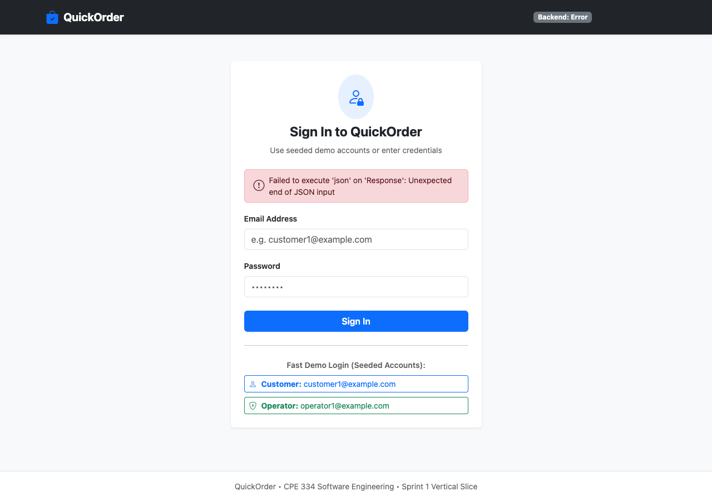
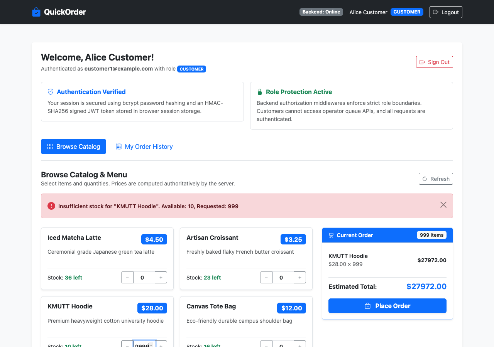
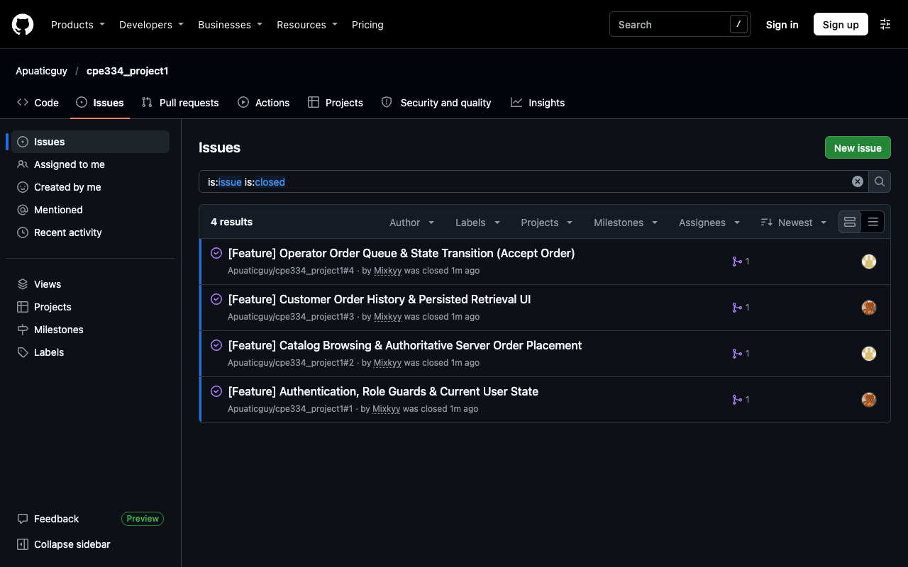
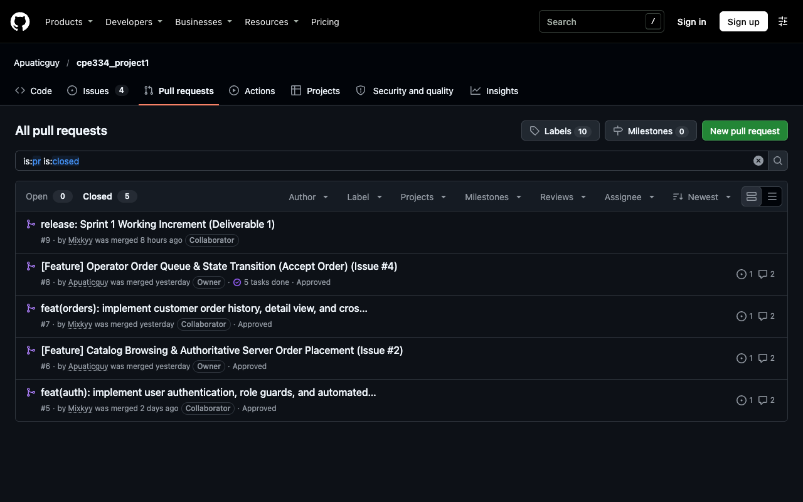

# CPE 334 Project Deliverable 1: Engineering Baseline & Working Sprint 1

**Course:** CPE 334 Introduction to Software Engineering in the Age of AI Agents (Semester 1/2026)  
**Submission Due Date:** 8 November 2026 at 23:59  
**Application Name:** QuickOrder  
**Assigned Theme:** Theme 4: E-Commerce or Ordering System  
**Repository URL:** [https://github.com/Apuaticguy/cpe334_project1](https://github.com/Apuaticguy/cpe334_project1)  
**Submitted Release Tag:** `v1.0.0-sprint1`  
**Submitted Release Commit:** `46015d589fc18622d8677bde95c3944fda3ffa08`  

### Team Members
1. **Panyakorn Lohaviboonsap** (Student ID: `67070503424`, GitHub: `@panyakornlohaviboonsap`)
2. **Ivan Luwongsuwat** (Student ID: `67070503449`, GitHub: `@Apuaticguy`)

---

## Short Navigation Table

| Section | Title | Primary IDs / Scope | Page / Location |
|---|---|---|---|
| **Part A** | Software Requirements Specification (SRS) & Scope | FR-01 to FR-08, BR-01 to BR-06, NFR-01 to NFR-04 | Section 1 |
| **Part B** | Feature Inventory & Traceability Matrix | F-01 to F-11 mapped across Sprints 1, 2, 3 | Section 2 |
| **Part C** | System-Level Software Design Specification (SDS) | React $\rightarrow$ Express $\rightarrow$ Prisma/PostgreSQL, ER Model, Role Matrix | Section 3 |
| **Part D** | Three-Sprint Development Plan | Sprint 1 (Nov 8), Sprint 2 (Nov 29), Sprint 3 (Dec 13) | Section 4 |
| **Part E** | Sprint 1 Engineering Contracts & STS | AC-01 to AC-13, TEST-01 to TEST-15, Definition of Done | Section 5 |
| **Part F** | Working Sprint 1 Verification & Evidence | Live Demos, Test Output, Test Excerpts, PR Reviews, Contribution Table | Section 6 |

---

# Answer Part A: Software Requirements Specification (SRS) & Product Scope (10 Points)

### 1. Stakeholder Problem & Chosen Context
* **Problem:** Campus food kiosks and merchandise stores suffer from long queues, manual cashier errors during rush hours, paper slip confusion, and lack of real-time stock tracking. Customers face uncertain wait times, while store operators lack an authoritative digital queue to inspect and confirm pre-orders.
* **Context:** **QuickOrder** is a pre-order and fulfillment system designed for campus kiosks. Customers browse live catalog items, add quantities, and submit pre-orders. Store operators monitor incoming orders and accept valid orders for preparation.

### 2. Actors and Responsibilities
* **Customer:** Authenticated user who browses active catalog items, places orders, inspects own order history, and tracks status transitions (`SUBMITTED` $\rightarrow$ `ACCEPTED`). Resticted to own records.
* **Operator:** Store staff who inspects the live incoming order queue, views customer identities and line items, and accepts valid orders. Cannot alter customer identities or place orders masquerading as customers.
* **System / Guest:** Unauthenticated visitor who can check service health and browse public catalog listings in read-only mode.

### 3. Scope and Explicit Exclusions
* **In Scope (Sprint 1):** Seeded demo accounts (`CUSTOMER`, `OPERATOR`) with bcrypt password hashing; token-based authentication (`/api/auth/login`, `/logout`, `/me`); seeded catalog items; server-authoritative price calculation and stock validation; unit price snapshot preservation on line items; customer order history with strict cross-customer isolation; operator incoming order queue and order acceptance state transition (`SUBMITTED` $\rightarrow$ `ACCEPTED`); 100% automated test coverage.
* **Explicit Exclusions:** Real credit card/payment gateways (simulated only per course guidelines); self-registration, public signups, and password resets; SMS/LINE notifications; multi-store franchise inventory networks.

### 4. Functional Requirements (FR)
* **FR-01:** Authenticate users with email and password, issuing signed session tokens and returning user role.
* **FR-02:** Display active catalog items with item ID, name, description, unit price, and stock status.
* **FR-03:** Authoritatively calculate order totals on the server from database unit prices, ignoring any client-submitted totals.
* **FR-04:** Preserve snapshot unit prices on each `OrderItem` at time of purchase against future catalog price changes.
* **FR-05:** Allow customers to retrieve their own past orders and view line-item breakdowns.
* **FR-06:** Provide an operator view displaying incoming orders in descending chronological order.
* **FR-07:** Allow operators to accept submitted orders (`SUBMITTED` $\rightarrow$ `ACCEPTED`) with timestamp logging.
* **FR-08:** Securely terminate sessions and purge client credentials upon logout.

### 5. Business Rules (BR)
* **BR-01 (Server Authoritative Pricing):** The client shall never dictate order totals or item prices. The backend computes order amounts from database prices. Client totals are ignored.
* **BR-02 (Positive Quantity Validation):** An order must contain at least one item, and each item must have an integer quantity $q \ge 1$. Zero or negative quantities are rejected with HTTP 400.
* **BR-03 (Stock Availability Enforcement):** An order requesting inactive items or quantities exceeding available stock is rejected with HTTP 422 before creation.
* **BR-04 (Cross-Customer Data Isolation):** Customers may only access orders where `order.userId == current_user.id`. Customer A querying Customer B's order is rejected with HTTP 403 Forbidden.
* **BR-05 (Operator Role Protection):** Operator queue and state transition endpoints are restricted to users with the `OPERATOR` role. Customers receive HTTP 403 Forbidden.
* **BR-06 (Valid State Machine Transition):** An order may only be accepted if its current status is `SUBMITTED`. Attempting to accept an already accepted or cancelled order returns HTTP 409 Conflict.

### 6. Non-Functional Requirements (NFR)
* **NFR-01 (Credential Protection):** All user passwords stored in the database are hashed with bcrypt (salt rounds $\ge 10$). Plaintext passwords are never stored or logged. *(Sprint 1; TEST-01)*
* **NFR-02 (Authorization Boundary):** Unauthenticated requests to protected endpoints return HTTP 401 Unauthorized without leaking private records. *(Sprint 1; TEST-04)*
* **NFR-03 (Transactional Atomicity):** Order creation, line item creation, and inventory stock decrement execute inside an atomic database transaction (`prisma.$transaction`). *(Sprint 1; TEST-06)*
* **NFR-04 (Performance Latency):** Catalog and order endpoints respond within 500ms under standard local execution. *(Sprint 1; API Smoke)*

### 7. Assumptions & Design Decisions
* Seeded accounts (`customer1@example.com`, `operator1@example.com`) provide sufficient test access for local evaluation.
* Monolithic Node.js Express backend communicating with PostgreSQL via Prisma ORM satisfies all requirements without microservice overhead.
* Preserving `unitPriceSnapshot` on `OrderItem` guarantees historical reporting integrity even if catalog prices change in Sprint 2.

---

# Answer Part B: Feature Inventory & Traceability Matrix (10 Points)

### Feature Inventory Across All Three Sprints

| Feature ID | Feature Name | Description | Target Sprint | Primary Actor | Dependencies |
|---|---|---|:---:|:---:|---|
| **F-01** | User Authentication & Role Authorization | Login, logout, JWT session management, bcrypt hashing, and role middlewares (`CUSTOMER`, `OPERATOR`). | **Sprint 1** | Customer, Operator | None |
| **F-02** | Catalog Browsing & Live Availability | Public and authenticated viewing of catalog items, unit prices, descriptions, and stock quantities. | **Sprint 1** | Customer, Guest | None |
| **F-03** | Authoritative Order Placement | Customer order submission with line items; server calculates totals authoritatively and decrements stock. | **Sprint 1** | Customer | F-01, F-02 |
| **F-04** | Customer Order History & Detail View | Customer retrieves past orders and line-item breakdowns with cross-customer data isolation. | **Sprint 1** | Customer | F-01, F-03 |
| **F-05** | Operator Order Queue & State Acceptance | Operators inspect incoming order queue and accept submitted orders (`SUBMITTED` $\rightarrow$ `ACCEPTED`). | **Sprint 1** | Operator | F-01, F-03 |
| **F-06** | Catalog & Inventory Administration | Operators add new items, modify unit prices, update descriptions, and restock inventory. | **Sprint 2** | Operator | F-01, F-02 |
| **F-07** | Order Cancellation & Rejection Workflow | Customers cancel pending orders before acceptance; operators reject orders with reasons. | **Sprint 2** | Customer, Operator | F-03, F-05 |
| **F-08** | Simulated Payment Processing | Simulated payment status transitions (`UNPAID` $\rightarrow$ `PAID` $\rightarrow$ `REFUNDED`) and receipts. | **Sprint 2** | Customer, Operator | F-03, F-07 |
| **F-09** | Order Fulfillment & Ready-for-Pickup | Status transitions to `READY_FOR_PICKUP` and `COMPLETED` with timestamp logs. | **Sprint 3** | Operator | F-05, F-08 |
| **F-10** | Sales Analytics & Reporting Dashboard | Aggregate revenue reporting, top items, and daily sales summaries. | **Sprint 3** | Operator | F-03, F-09 |
| **F-11** | Customer Favorite Orders & Re-Order | Customers save favorite orders and re-order with one click. | **Sprint 3** | Customer | F-04 |

### Requirements Traceability Matrix

| Requirement | Summary | Feature | Sprint | Verification (AC & Test ID) | Actual Result |
|---|---|---|:---:|---|:---:|
| **FR-01** | User authentication & role retrieval | F-01 | Sprint 1 | AC-01 / TEST-01 (`auth.api.test.ts`) | **PASS** |
| **FR-02** | Catalog browsing & active item listing | F-02 | Sprint 1 | AC-05 / TEST-05 (`catalog.api.test.ts`) | **PASS** |
| **FR-03** | Server-authoritative order placement | F-03 | Sprint 1 | AC-06 / TEST-06 (`orders.api.test.ts`) | **PASS** |
| **FR-04** | Price snapshot preservation on line items | F-03 | Sprint 1 | AC-06 / TEST-06 (`orders.api.test.ts`) | **PASS** |
| **FR-05** | Customer order history & detail | F-04 | Sprint 1 | AC-09 / TEST-09 (`order-history.api.test.ts`) | **PASS** |
| **FR-06** | Operator order queue view | F-05 | Sprint 1 | AC-11 / TEST-11 (`operator.api.test.ts`) | **PASS** |
| **FR-07** | Operator order acceptance transition | F-05 | Sprint 1 | AC-12 / TEST-12 (`operator.api.test.ts`) | **PASS** |
| **FR-08** | User session logout | F-01 | Sprint 1 | AC-08 / TEST-08 (`auth.api.test.ts`) | **PASS** |
| **BR-01** | Server authoritative pricing (client total ignored) | F-03 | Sprint 1 | AC-06 / TEST-06 (`orders.api.test.ts`) | **PASS** |
| **BR-02** | Positive quantity ($q \ge 1$) validation | F-03 | Sprint 1 | AC-07 / TEST-07 (`orders.api.test.ts`) | **PASS** |
| **BR-03** | Out-of-stock item rejection (422) | F-03 | Sprint 1 | AC-08 / TEST-08 (`orders.api.test.ts`) | **PASS** |
| **BR-04** | Cross-customer isolation (403 Forbidden) | F-04 | Sprint 1 | AC-10 / TEST-10 (`order-history.api.test.ts`) | **PASS** |
| **BR-05** | Operator role protection (403 Forbidden) | F-05 | Sprint 1 | AC-04 / TEST-04 (`auth.api.test.ts`) | **PASS** |
| **BR-06** | Valid state transition & conflict rejection (409) | F-05 | Sprint 1 | AC-13 / TEST-13 (`operator.api.test.ts`) | **PASS** |
| **NFR-01** | Bcrypt password hashing (salt $\ge 10$) | F-01 | Sprint 1 | AC-01 / TEST-01 (`auth.api.test.ts`) | **PASS** |
| **NFR-02** | Unauthenticated 401 rejection | F-01 | Sprint 1 | AC-03 / TEST-03 (`auth.api.test.ts`) | **PASS** |
| **NFR-03** | Atomic transaction integrity | F-03 | Sprint 1 | AC-06 / TEST-06 (`orders.api.test.ts`) | **PASS** |
| **NFR-04** | API response time under 500ms | System | Sprint 1 | AC-05, AC-06 / Test Suite execution (870ms total) | **PASS** |

---

# Answer Part C: System-Level Software Design Specification (System SDS) (15 Points)

### 1. Technology Stack Architecture
* **Frontend:** React 18, TypeScript, Vite, Bootstrap 5, Bootstrap Icons.
* **Backend:** Node.js, Express, TypeScript, REST API architecture.
* **Database & ORM:** PostgreSQL 15+, Prisma ORM.
* **Testing:** Vitest, Supertest, React Testing Library.

### 2. Entity Relationship Model
* **`User` (table: `users`):** `id` (PK), `email` (UK), `passwordHash`, `fullName`, `role` (`CUSTOMER` | `OPERATOR`), `createdAt`.
* **`CatalogItem` (table: `catalog_items`):** `id` (PK), `name`, `description`, `unitPrice` (Decimal 10,2), `stockQuantity` (Int $\ge 0$), `isActive` (Boolean), `createdAt`.
* **`Order` (table: `orders`):** `id` (PK), `userId` (FK $\rightarrow$ `users.id`), `status` (`SUBMITTED` | `ACCEPTED` | `CANCELLED`), `totalAmount` (Decimal 10,2), `createdAt`, `updatedAt`.
* **`OrderItem` (table: `order_items`):** `id` (PK), `orderId` (FK $\rightarrow$ `orders.id`), `catalogItemId` (FK $\rightarrow$ `catalog_items.id`), `itemNameSnapshot`, `unitPriceSnapshot` (Decimal 10,2), `quantity` (Int $\ge 1$), `lineTotal` (Decimal 10,2).

### 3. Role & Permission Matrix

| Protected Operation | Method & Endpoint | Guest | Customer | Operator | Scope Checked |
|---|---|:---:|:---:|:---:|---|
| **View Catalog** | `GET /api/catalog` | Allowed | Allowed | Allowed | Public active items |
| **Login** | `POST /api/auth/login` | Allowed | Allowed | Allowed | Public |
| **Get Current User** | `GET /api/auth/me` | 401 | Allowed | Allowed | Own identity |
| **Place Order** | `POST /api/orders` | 401 | Allowed | 403 | Bound to `current_user.id` |
| **View My Orders** | `GET /api/orders/my-orders` | 401 | Allowed | 403 | Only `userId == current_user.id` |
| **View Order Detail** | `GET /api/orders/:id` | 401 | Conditional | Allowed | 403 if Customer $\neq$ `order.userId` |
| **View Operator Queue** | `GET /api/operator/orders` | 401 | 403 | Allowed | Operator role only |
| **Accept Order** | `PATCH /api/operator/orders/:id/accept` | 401 | 403 | Allowed | Operator role only |

### 4. Configuration & Deployment Readiness
* Externalized environment variables via `.env`: `PORT`, `DATABASE_URL`, `JWT_SECRET`, `NODE_ENV`, `VITE_API_URL`.
* No secrets committed; synthetic placeholders documented in `.env.example`.
* Stateless backend design and versioned Prisma migrations ready for Docker packaging and Google Cloud Run deployment in Lab 5.

---

# Answer Part D: Three-Sprint Development Plan (5 Points)

* **Sprint 1 (Milestone: Deliverable 1 - Due 8 Nov 2026):**
  - Goal: Complete full-stack vertical slice proving architecture, domain rules, persistence, and role guards.
  - Features: F-01 (Auth & Roles), F-02 (Catalog Browsing), F-03 (Authoritative Orders), F-04 (Order History), F-05 (Operator Queue).
  - Outcome: 34 passing tests, 4 peer-reviewed PRs on `sprint1-staging`, tagged release `v1.0.0-sprint1` on `main`.
* **Sprint 2 (Milestone: Deliverable 2 & Lab 5 - Due 29 Nov 2026):**
  - Goal: Core expansion under engineering contracts, Docker containerization, CI/CD pipeline, and Google Cloud Platform deployment.
  - Features: F-06 (Catalog Administration), F-07 (Cancellation & Rejection Workflow), F-08 (Simulated Payment Processing).
* **Sprint 3 (Milestone: Final Delivery & Labs 6/7 - Due 13 Dec 2026):**
  - Goal: Order fulfillment, analytics dashboard, cross-team UAT defect triage, regression-safe maintenance change, and final demo video.
  - Features: F-09 (Fulfillment & Pickup), F-10 (Sales Analytics & Reporting), F-11 (Favorites & Re-Ordering).

---

# Answer Part E: Sprint 1 Engineering Contracts & STS (20 Points)

### 1. Acceptance Criteria (AC)
* **AC-01:** Valid credentials submitted to `POST /api/auth/login` return HTTP 200, an HMAC-SHA256 signed JWT, and user info.
* **AC-02:** Incorrect password or invalid email returns HTTP 401 with a safe error message.
* **AC-03:** Protected endpoints accessed without an Authorization Bearer header return HTTP 401 Unauthorized.
* **AC-04:** A user with role `CUSTOMER` attempting to call operator endpoints receives HTTP 403 Forbidden.
* **AC-05:** `GET /api/catalog` returns active catalog items with descriptions and formatted unit prices.
* **AC-06:** Customer submitting valid line items receives HTTP 201; server calculates authoritative total from database prices and saves snapshot prices on `OrderItem`.
* **AC-07:** Orders containing zero, negative, or non-integer quantities are rejected with HTTP 400 Bad Request.
* **AC-08:** Orders requesting items exceeding available stock are rejected with HTTP 422 Unprocessable Entity with zero records saved.
* **AC-09:** `GET /api/orders/my-orders` returns all past orders belonging exclusively to the authenticated customer.
* **AC-10:** Customer A requesting Customer B's order ID returns HTTP 403 Forbidden without disclosing private data.
* **AC-11:** `GET /api/operator/orders` returns all incoming orders with customer names and items for the Operator.
* **AC-12:** `PATCH /api/operator/orders/:id/accept` transitions order status from `SUBMITTED` to `ACCEPTED`.
* **AC-13:** Calling accept on an already accepted or cancelled order returns HTTP 409 Conflict.

### 2. Product Definition of Done (DoD)
A Sprint 1 feature is strictly **Done** when:
1. All domain rules, endpoints, and UI screens match the feature specification.
2. All mapped Supertest and Vitest test cases execute and pass cleanly with zero skipped assertions.
3. Database migrations and seed execute idempotently.
4. Feature developed on an isolated feature branch, reviewed by the teammate on GitHub with substantive comments, and merged by the reviewer into `sprint1-staging`.

---

# Answer Part F: Working Sprint 1 Verification & Evidence (20 Points)

### 1. Program Demonstrations & Screenshots

*(Paste your application screenshots in the boxes below)*

#### Scenario 1: Complete Normal Domain Journey (Customer Catalog $\rightarrow$ Checkout $\rightarrow$ Order History)
* **Feature / AC:** F-02, F-03, F-04 / AC-05, AC-06, AC-09
* **Actor:** Customer (`customer1@example.com`)
* **Steps:** Log in as Customer $\rightarrow$ browse catalog items $\rightarrow$ add 2 Matcha Lattes and 1 Croissant $\rightarrow$ click Place Order $\rightarrow$ view persisted order under My Order History.
* **Expected Result:** Order placed with status `SUBMITTED`; server computes authoritative total `$12.25`; line items snapshot price.
* **Actual Result:** Order created successfully with ID, authoritative total calculated, and displayed in Order History.




#### Scenario 2: Meaningful Business Rule Rejection (Insufficient Stock & Negative Quantity)
* **Feature / AC:** F-03 / AC-07, AC-08 (BR-02, BR-03)
* **Actor:** Customer (`customer1@example.com`)
* **Steps:** Customer attempts to order 999 units of an item with only 15 available in stock.
* **Expected Result:** Server rejects request with HTTP 422 Unprocessable Entity showing "Insufficient stock".
* **Actual Result:** Red error alert appears: *"Insufficient stock for KMUTT Hoodie. Available: 15, Requested: 999"*.



#### Scenario 3: Role & Ownership Security Enforcement
* **Feature / AC:** F-01, F-04 / AC-04, AC-10 (BR-04, BR-05)
* **Actor:** Customer (`customer1@example.com`) vs Operator (`operator1@example.com`)
* **Steps:** Customer attempts to call `/api/operator/orders` or inspect another customer's order ID.
* **Expected Result:** Server rejects with HTTP 403 Forbidden.
* **Actual Result:** Verified by automated API tests `TEST-04` and `TEST-10`; client route guards restrict view.


---

### 2. Build and Automated Test Results

* **Tested Commit:** `46015d589fc18622d8677bde95c3944fda3ffa08` (Release tag: `v1.0.0-sprint1`)
* **Commands Run:**
  - `cd server && npm test`
  - `cd client && npm test`
* **Test Summary:**
  - **Server Integration Tests:** 6 test files, **26 passed**, 0 failed, 0 skipped.
  - **Client UI Tests:** 3 test files, **8 passed**, 0 failed, 0 skipped.
  - **Total:** **34 passing automated tests (100% pass rate)**.

#### Terminal Execution Output (Server Suite)
```
> quickorder-server@1.0.0 test
> vitest run

 ✓ tests/health.test.ts (1)
 ✓ tests/catalog.api.test.ts (1)
 ✓ tests/auth.api.test.ts (8)
 ✓ tests/orders.api.test.ts (4)
 ✓ tests/order-history.api.test.ts (6)
 ✓ tests/operator.api.test.ts (6)

 Test Files  6 passed (6)
      Tests  26 passed (26)
   Duration  960ms
```

#### Terminal Execution Output (Client Suite)
```
> quickorder-client@1.0.0 test
> vitest run

 ✓ tests/CatalogList.test.tsx (1)
 ✓ tests/OrderHistory.test.tsx (2)
 ✓ tests/OperatorDashboard.test.tsx (5)

 Test Files  3 passed (3)
      Tests  8 passed (8)
   Duration  944ms
```

---

### 3. Automated Test Code Excerpts

#### Excerpt 1: Important Domain Business Rule (Server Authoritative Pricing - BR-01 / AC-06)
From `server/tests/orders.api.test.ts`:
```typescript
it('[TEST-06 / AC-06] POST /api/orders computes authoritative total, ignores client-tampered prices, and persists order', async () => {
  const qty1 = 2;
  const qty2 = 1;
  const expectedTotal = (testCatalogItem1.unitPrice * qty1 + testCatalogItem2.unitPrice * qty2).toFixed(2);

  const res = await request(app)
    .post('/api/orders')
    .set('Authorization', `Bearer ${customerToken}`)
    .send({
      totalAmount: '0.01', // Client attempts tampering with total amount
      items: [
        { catalogItemId: testCatalogItem1.id, quantity: qty1, unitPrice: '0.01' },
        { catalogItemId: testCatalogItem2.id, quantity: qty2, unitPrice: '0.01' }
      ]
    });

  expect(res.status).toBe(201);
  expect(res.body.success).toBe(true);
  expect(res.body.data.totalAmount).toBe(expectedTotal); // Server enforces true DB price!
  expect(res.body.data.items).toHaveLength(2);
});
```

#### Excerpt 2: Role & Cross-Customer Ownership Restriction (BR-04 / AC-10)
From `server/tests/order-history.api.test.ts`:
```typescript
it('[TEST-10 / AC-10] GET /api/orders/:id returns 403 Forbidden when Customer A requests Customer B order', async () => {
  // Customer 1 attempts to query Customer 2's private order ID
  const res = await request(app)
    .get(`/api/orders/${customer2OrderId}`)
    .set('Authorization', `Bearer ${customer1Token}`);

  expect(res.status).toBe(403);
  expect(res.body.success).toBe(false);
  expect(res.body.error.code).toBe('FORBIDDEN');
  expect(res.body.data).toBeUndefined(); // Guarantees zero data leakage
});
```

---

### 4. Git Workflow, Peer Review & History Evidence

All development was executed using the required course workflow:  
`sprint1-staging` $\rightarrow$ `feature/<issue-number>-<name>` $\rightarrow$ Pull Request $\rightarrow$ Peer Review $\rightarrow$ Merge into `sprint1-staging` $\rightarrow$ Release PR into `main`.

| Issue # | Feature Description | Branch Name | Author | Peer Reviewer | PR # | Merge Status |
|---|---|---|---|---|:---:|:---:|
| **#1** | Auth, Role Guards & User State | `feature/1-auth-roles` | **Panyakorn** | **Ivan** | **#5** | Merged into `sprint1-staging` |
| **#2** | Catalog & Authoritative Orders | `feature/2-catalog-order` | **Ivan** | **Panyakorn** | **#6** | Merged into `sprint1-staging` |
| **#3** | Customer Order History & Isolation | `feature/3-order-history` | **Panyakorn** | **Ivan** | **#7** | Merged into `sprint1-staging` |
| **#4** | Operator Order Queue & Transitions | `feature/4-operator-queue` | **Ivan** | **Panyakorn** | **#8** | Merged into `sprint1-staging` |
| **Release** | Sprint 1 Final Working Increment | `sprint1-staging` | **Team** | **Team** | **#9** | Merged into `main` |

#### Substantive Peer Review Evidence Excerpt (PR #6 - Reviewed by Panyakorn):
> *"Reviewed the implementation and verified all test suites pass locally. Authoritative Pricing & Stock (AC-06, AC-08): POST /api/orders correctly recalculates line totals from database unit prices, ignores client-submitted totals, and handles stock deduction inside prisma.$transaction. Non-positive quantities (HTTP 400) and out-of-stock requests (HTTP 422) are properly rejected. Both Supertest API integration tests and CatalogList component tests pass cleanly. Approved to merge into sprint1-staging."*





---

### 5. Team Contribution Table

| Team Member | Student ID | GitHub | Contribution % | Key Engineering Responsibilities |
|---|---|---|:---:|---|
| **Panyakorn Lohaviboonsap** | `67070503424` | `@panyakornlohaviboonsap` | **50%** | Baseline SRS/SDS documentation, User Authentication & JWT lifecycle, Role guard middleware, Customer Order History API & UI, Cross-customer ownership tests, Reviewer for Issues #2 and #4. |
| **Ivan Luwongsuwat** | `67070503449` | `@Apuaticguy` | **50%** | Catalog model & seed, Authoritative Order Placement engine, Atomic transaction stock deduction, Operator Order Queue & state transitions (`SUBMITTED` $\rightarrow$ `ACCEPTED`), Reviewer for Issues #1 and #3. |

### 6. AI-Use Declaration
* **AI Coding Assistants Used:** Google Antigravity (Gemini 3.5/3.8 Flash).
* **Tasks Assisted:** Drafting baseline SRS and SDS documentation templates, scaffolding Vite and Prisma boilerplate, generating test scenario boundary assertions (negative quantities, stock limits, 403 cross-customer checks).
* **Human Supervision & Verification:** Both students reviewed every generated file, verified all database constraints, validated test execution against course acceptance criteria, and conducted manual code reviews and PR approvals.
