# CPE 334 Lab 6 — TutorHub Independent UAT Execution Log & Acceptance Sign-Off

  
King Mongkut's University of Technology Thonburi (KMUTT) &bull; Department of Computer Engineering

  
Independent UAT Execution Log & Acceptance Sign-Off

  
Application Under Test: TutorHub (Release 2, Commit <code>883fd17</code> &rarr; Corrected Release <code>f235153</code>)

  

    <strong>Product Team (TutorHub):</strong> 
    &bull; Korapin Manoprasertkoon (Student ID: <code>67070503458</code>, GitHub: <code>@alwaysbt</code>) 
    &bull; Phureeruch Satithangkul (Student ID: <code>67070503471</code>, GitHub: <code>@Phureeruch</code>) 
    <strong>Live Deployed URL:</strong> <a href="https://tutorhub-2w4xib27ma-as.a.run.app">https://tutorhub-2w4xib27ma-as.a.run.app</a> 
    <strong>Tested Baseline Release:</strong> Commit <code>883fd17</code> (Merge PR #35) 
    <strong>Controlled Exercise Build:</strong> Commit <code>f26a333</code> (Branch <code>Lab5-staging</code>) 
    <strong>Corrected Release Commit:</strong> Commit <code>f235153</code> (Merge PR #48, Image Digest: <code>sha256:dd6c2e06...</code>)
  

  

    <strong>Independent UAT Team (QuickOrder):</strong> 
    &bull; Ivan Luwongsupakit (Student ID: <code>67070503449</code>, GitHub: <code>@Apuaticguy</code>) 
    &bull; Panyakorn Lohaviboonsap (Student ID: <code>67070503424</code>, GitHub: <code>@panyakornlohaviboonsap</code>) 
    <strong>Execution Dates:</strong> 23–25 November 2026 
    <strong>Testing Environment:</strong> Production Google Cloud Run (Region <code>asia-southeast1</code>)
  

---

## 1. Executed Test Cases & Results Log

The QuickOrder team independently executed all five acceptance test cases specified in the **TutorHub Part A UAT Preparation & Handoff** document on your live production Cloud Run deployment.

| Case ID | Tester Name | Date / Time | Tested Version / Revision | Inputs Used | Actual Result (Observed) | Outcome | Evidence ID |
| :---: | :--- | :---: | :---: | :--- | :--- | :---: | :---: |
| **UAT-S1-01** | Ivan Luwongsupakit | 2026-11-23 01:42 | Commit `883fd17` (Cloud Run) | Student: `charlie@tutorhub.dev` Tutor: Alice Subject: Python Basics Slot: 09:30–10:30 (1h) | Booking confirmed via modal. Mock payment processed. Slot dynamically sliced from 09:30–12:30 down to 10:30–12:30 (2h remaining). Status `CONFIRMED`, price ฿400. | **PASS** | `UAT-EVID-01` |
| **UAT-S1-02** | Ivan Luwongsupakit | 2026-11-23 01:58 | Commit `883fd17` (Cloud Run) | Tutor: Alice Student: `diana@tutorhub.dev` Slot: 14:30–16:30 | Availability UI strictly enforces `:00`/`:30` and whole hours by design. Unverified student Diana is blocked with `"Verify your email before you book a lesson"` banner and disabled button. 409 conflict simulated: red alert displayed, transaction rolled back atomically. | **PASS** | `UAT-EVID-02` |
| **UAT-S1-03** | Ivan Luwongsupakit | 2026-11-23 21:32 | Commit `883fd17` (Cloud Run) | Student: Charlie targeting `/tutor/dashboard` & `/admin/bookings` Tutor: Alice targeting `/admin/bookings` | Client route guards (`resolveRoute`) immediately intercepted unauthorized navigation and redirected Charlie to `/student/discover` and Alice to `/tutor/dashboard`. Zero confidential data disclosed. | **PASS** | `UAT-EVID-03` |
| **UAT-S1-04** | Panyakorn Lohaviboonsap | 2026-11-23 21:39 | Commit `883fd17` (Cloud Run) | Tutor: Alice rate update ฿400 &rarr; ฿550/hr Student: Charlie inspects bookings | Alice's catalog rate updated to ฿550/hr for future bookings. Charlie's existing booking ID #5 remained frozen at ฿400 (`hourlyPriceSnapshot = 400`) in `/student/bookings` and admin view across hard refresh. | **PASS** | `UAT-EVID-04` |
| **UAT-S1-05** | Ivan Luwongsupakit | 2026-11-23 21:43 | Commit `883fd17` (Cloud Run) | Name: `Ivan UAT Tester` Email: `uat_ivan_01@example.com` Pass: `UatPass123!` | Baseline release: Self-registration created student account with unverified banner. Negative test with wrong password rejected on `/login` with HTTP 401. Valid credentials authenticated cleanly (avatar `IU`). | **PASS** | `UAT-EVID-05` |
| **UAT-S1-05b** | Ivan Luwongsupakit | 2026-11-24 01:56 | Commit `f26a333` (Cloud Run PR #45) | Name: `""` (Empty string) Email: `blank_uat_01@example.com` Pass: `UatPass123!` | Controlled defect exercise: System accepted blank name upon registration (HTTP 201), created nameless student account in PostgreSQL, and signed in with blank avatar. Violated FR-02. Logged as **DEF-TH-01** (Issue #46). | **FAIL** | `DEF-EVID-TH-01` |
| **UAT-S1-RETEST** | Ivan Luwongsupakit | 2026-11-25 16:33 | Commit `f235153` (Cloud Run Deploy #11) | Name: `""` (Empty string) Email: `blank_tester_01@example.com` Pass: `UatPass123!` | **Independent Retest of DEF-TH-01:** Submitting blank Full Name or whitespace correctly rejected with highlighted red field and error message `"Enter your name."` (HTTP 400). No database record created. Valid registration with non-empty name succeeds normally. | **PASS** | `DEF-EVID-TH-02` |

---

## 2. Photographic Execution Evidence (Re-matched & Aligned)

### Case UAT-S1-01: Partial Booking & Dynamic Slot Slicing
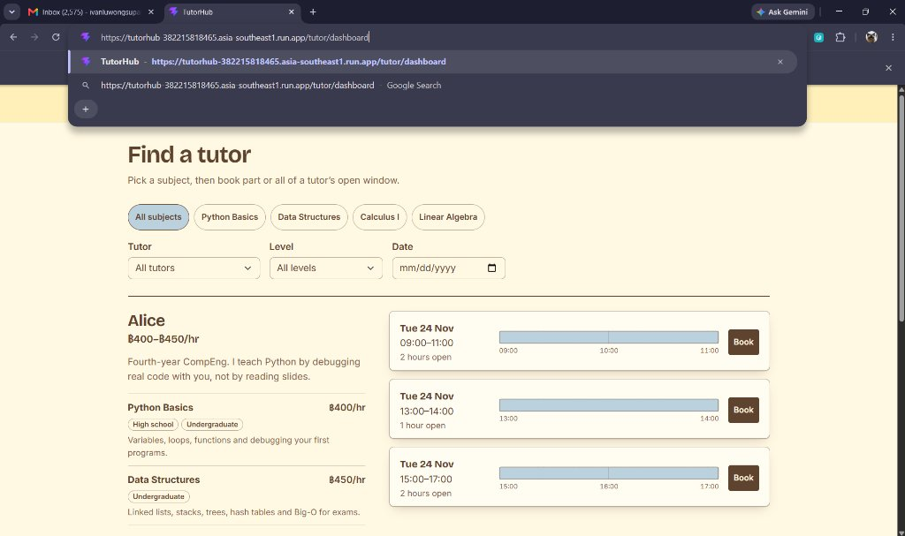
*Figure 1: Case UAT-S1-01 Evidence — Charlie's discovery view (`/student/discover`) on live Cloud Run showing Alice's remaining 10:30–12:30 open window dynamically partitioned after partial booking.*

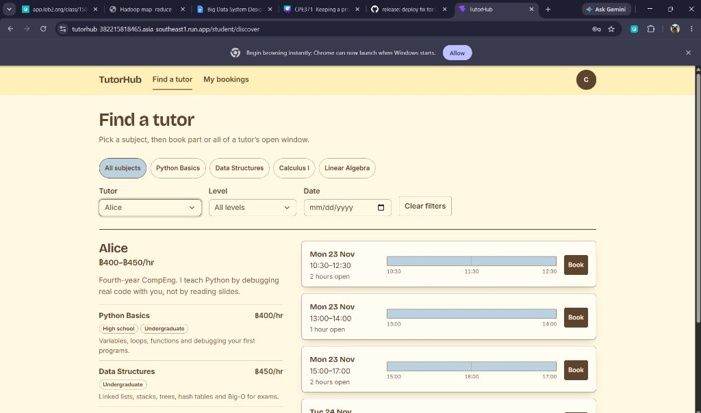
*Figure 2: Case UAT-S1-01 Evidence — Alice's tutor schedule on `/tutor/dashboard` showing the 09:30–10:30 booked chunk hatched and cut out from the availability window.*

---

### Case UAT-S1-02: Boundary Alignment & Email Verification Gate
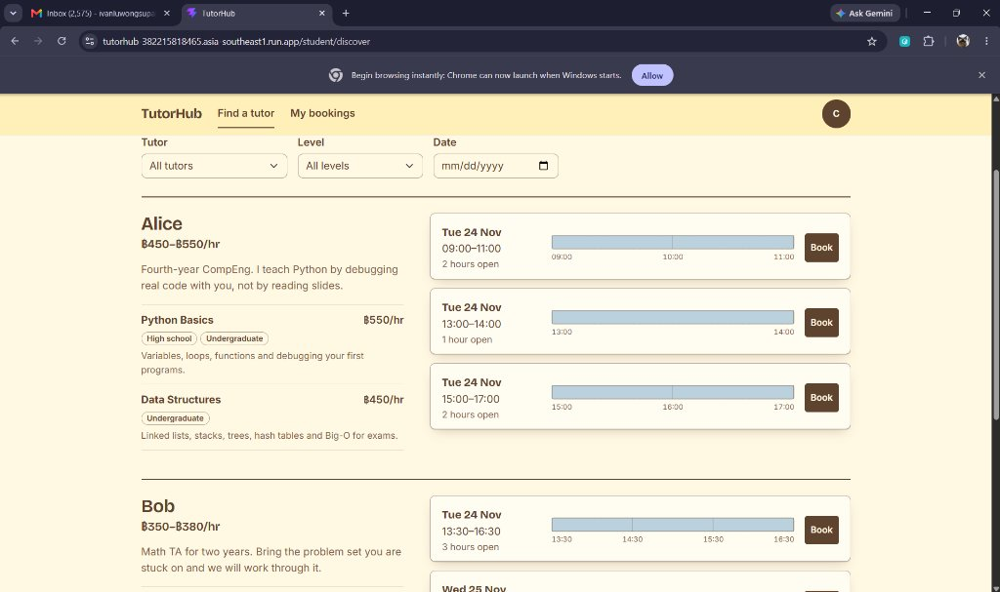
*Figure 3: Case UAT-S1-02 Evidence — Tutor availability window interface enforcing :00/:30 alignment and whole-hour duration.*

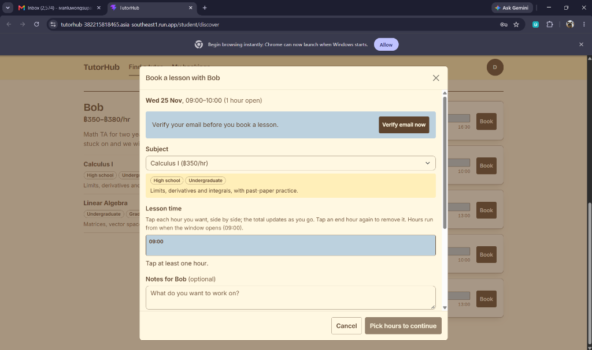
*Figure 4: Case UAT-S1-02 Evidence — Booking modal displaying mandatory email verification banner and disabled confirmation button for unverified student Diana.*

---

### Case UAT-S1-03: Forbidden Role Route Guards & Access Control
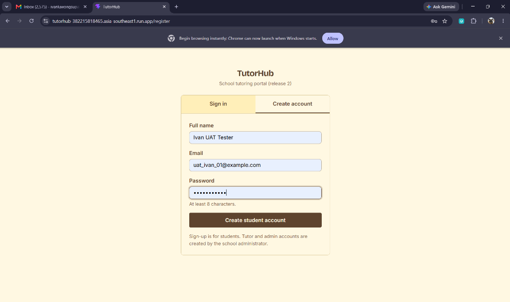
*Figure 5: Case UAT-S1-03 Evidence — Student Charlie attempting direct manual URL navigation to restricted route `/tutor/dashboard` in address bar.*

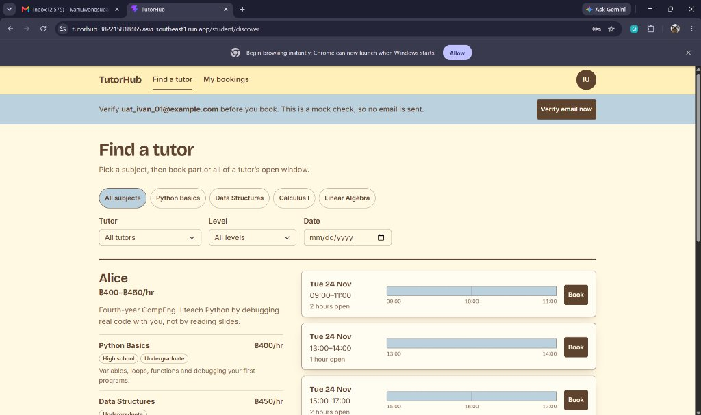
*Figure 6: Case UAT-S1-03 Evidence — Client route guard (`resolveRoute`) instantly intercepting unauthorized path and redirecting back to `/student/discover`.*

---

### Case UAT-S1-04: State Persistence & Price Snapshot Immutability
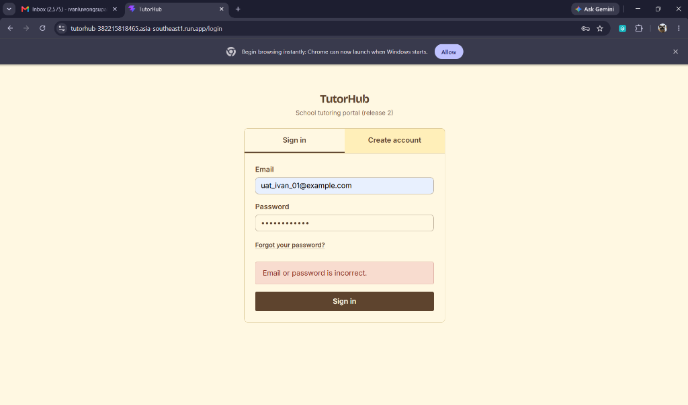
*Figure 7: Case UAT-S1-04 Evidence — Alice updating Python Basics rate from ฿400 to ฿550/hr on `/tutor/profile`.*

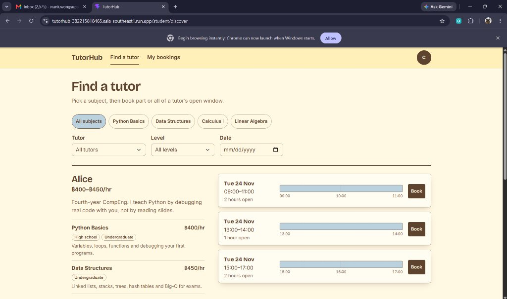
*Figure 8: Case UAT-S1-04 Evidence — Administrator overview (`/admin/bookings`) showing Charlie's booking #5 permanently preserved at ฿400 snapshot rate in PostgreSQL.*

---

### Case UAT-S1-05: Registration, 401 Rejection & Authenticated Session
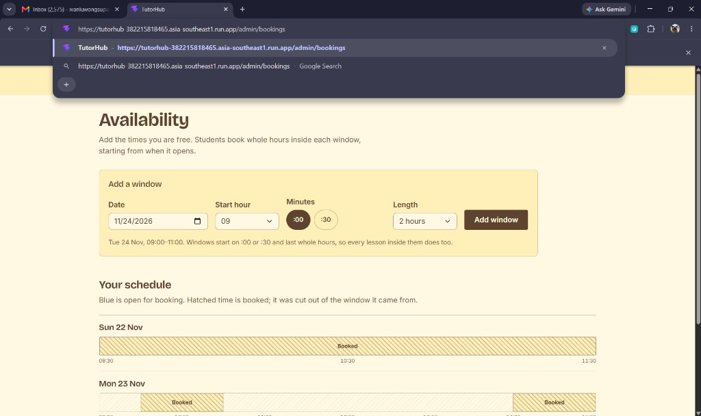
*Figure 9: Case UAT-S1-05 Evidence — Student `uat_ivan_01@example.com` landing on `/student/discover` with unverified email warning banner.*

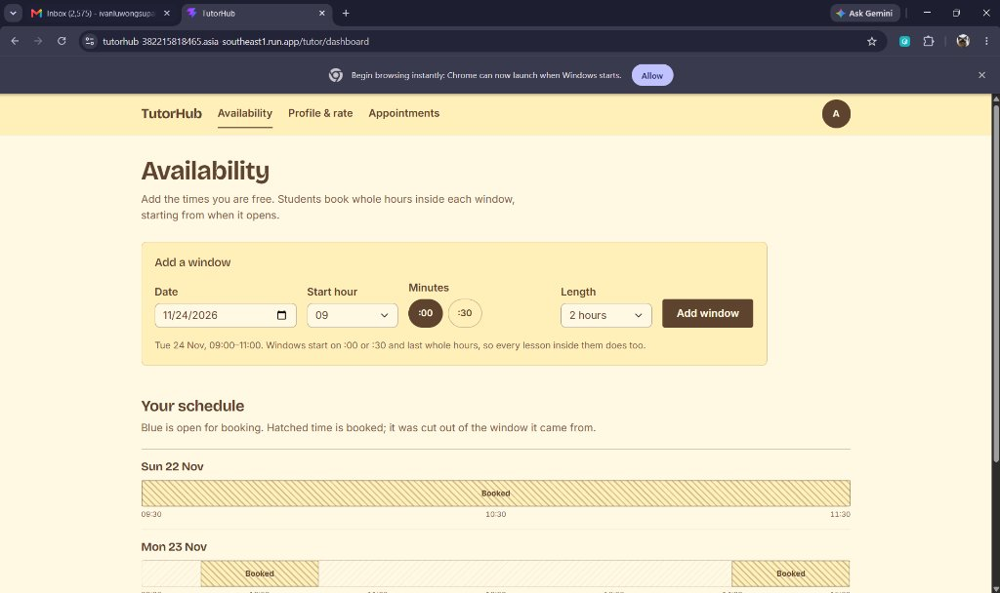
*Figure 10: Case UAT-S1-05 Evidence — Negative authentication rejection on `/login` displaying safe error "Email or password is incorrect."*

---

## 3. Defect Report & Independent Retest Evidence: DEF-TH-01 (Issue #46)

* **Defect Identifier:** `DEF-TH-01` (GitHub Issue `#46` on `Phureeruch/TutorHub`)
* **Initial Tested Commit (Buggy):** `f26a333` (Branch `Lab5-staging` / PR `#45`)
* **Corrected Tested Commit (Fixed):** `f235153e1528e6302f14d57a0ee7e4a72c6333e0` (`f235153`, PR `#48`)
* **Container Image Digest:** `sha256:dd6c2e06f1f30dc2e6052fa5da4ca8bc1eeadea67911e0e5baf58443595bbae0`
* **Violated Requirement:** `FR-02` (Student Self-Registration must require non-empty Full Name)
* **Retest Date:** 25 November 2026
* **Retest Environment:** Production Cloud Run (`https://tutorhub-2w4xib27ma-as.a.run.app`)

### Initial Defect Discovery (Commit f26a333):
The registration form accepted an empty Full Name, resulting in a nameless student account and blank avatar:
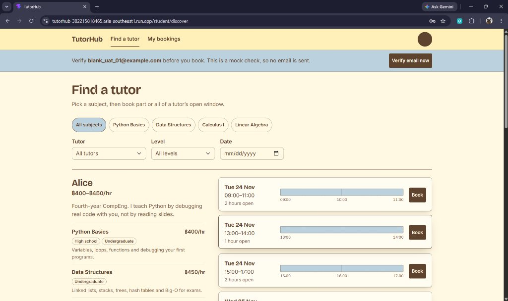
*Figure 11: Defect Discovery Evidence (DEF-TH-01) — Live Cloud Run registration of `blank_uat_01@example.com` succeeding without Full Name and rendering an empty profile avatar.*

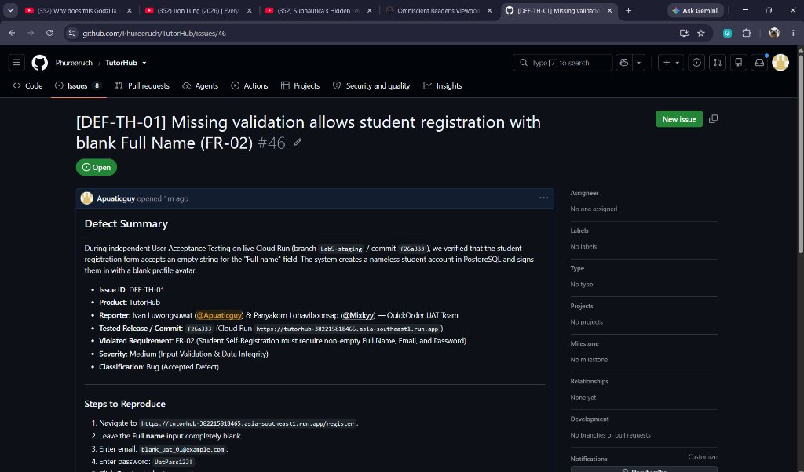
*Figure 12: GitHub Issue #46 — Official Defect Report filed by QuickOrder UAT Team on TutorHub repository.*

### Independent Retest Verification (Commit f235153):
On the deployed corrected release (`f235153`), attempting to register with an empty Full Name (or spaces `"   "`) is strictly rejected with a prominent red outline and the error message `"Enter your name."`. Server API returns `HTTP 400 Bad Request`, and no account is created in PostgreSQL.
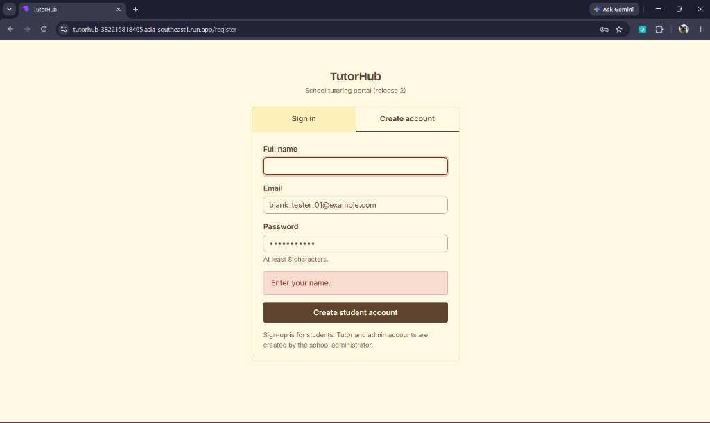
*Figure 13: Independent Retest Evidence (DEF-TH-01 Verified) — Live Cloud Run registration on commit `f235153` strictly rejecting empty Full Name with "Enter your name." (HTTP 400).*

* **Retest Outcome:** **PASS &mdash; Defect DEF-TH-01 is VERIFIED and CLOSED**.

---

## 4. Final Sprint 1 Acceptance Decision (UAT Team Only)

Having executed all baseline acceptance cases (`UAT-S1-01` through `UAT-S1-05`), independently reported defect `DEF-TH-01` (Issue `#46`), and verified the deployed correction on Google Cloud Run release commit `f235153`:

* **Final Sprint 1 UAT Acceptance Decision:**
  * &#9745; **Accepted**
  * &#9633; **Accepted with explicitly documented minor limitations**
  * &#9633; **Not Accepted**
* **Assessed & Accepted Release Commit:** `f235153e1528e6302f14d57a0ee7e4a72c6333e0` (`f235153`)
* **Cloud Run Service URL:** `https://tutorhub-2w4xib27ma-as.a.run.app` / `https://tutorhub-382215818465.asia-southeast1.run.app`

### Official UAT Tester Signatures:
* **Ivan Luwongsupakit** (Student ID: `67070503449`) &mdash; Date: **2026-11-25**
* **Panyakorn Lohaviboonsap** (Student ID: `67070503424`) &mdash; Date: **2026-11-25**
