# CPE 334 — Group Lab 6 Engineering Dossier: Independent User Acceptance Testing and Defect Management

<div class="university-header">
  <div class="sub-title">King Mongkut's University of Technology Thonburi (KMUTT) &bull; Department of Computer Engineering</div>
  <div class="main-title">Group Lab 6: Independent User Acceptance Testing & Defect Management</div>
  <div class="sub-title">Course: CPE 334 Introduction to Software Engineering in the Age of AI Agents (Semester 1/2026)</div>
</div>

<div class="meta-grid">
  <div>
    <strong>Product Team (QuickOrder):</strong><br>
    &bull; Panyakorn Lohaviboonsap (Student ID: <code>67070503424</code>, GitHub: <code>@panyakornlohaviboonsap</code>)<br>
    &bull; Ivan Luwongsupakit (Student ID: <code>67070503449</code>, GitHub: <code>@Apuaticguy</code>)<br>
    <strong>Application:</strong> QuickOrder (Campus Pre-Order & Fulfillment System)<br>
    <strong>Repository:</strong> <a href="https://github.com/Apuaticguy/cpe334_project1">https://github.com/Apuaticguy/cpe334_project1</a><br>
    <strong>Live Deployed URL:</strong> <a href="https://quickorder-wcdixtgbxq-as.a.run.app">https://quickorder-wcdixtgbxq-as.a.run.app</a><br>
    <strong>Sprint 1 Baseline Tag / Commit:</strong> <code>v1.0.0-sprint1</code> / Commit <code>25dc85f</code><br>
    <strong>Corrected Deployed Release:</strong> Commit <code>8d400ad</code> (Cloud Run Revision <code>quickorder-00008-xyz</code>)<br>
    <strong>Incoming Defect Resolved:</strong> <code>DEF-QO-01</code> (GitHub Issue <code>#27</code> &mdash; Verified & Closed)
  </div>
  <div>
    <strong>Partner UAT Team (TutorHub):</strong><br>
    &bull; Korapin Manoprasertkoon (Student ID: <code>67070503458</code>, GitHub: <code>@alwaysbt</code>)<br>
    &bull; Phureeruch Satithangkul (Student ID: <code>67070503471</code>, GitHub: <code>@Phureeruch</code>)<br>
    <strong>Application:</strong> TutorHub (Peer Tutoring & Lesson Scheduling Platform)<br>
    <strong>Repository:</strong> <a href="https://github.com/Phureeruch/TutorHub.git">https://github.com/Phureeruch/TutorHub.git</a><br>
    <strong>Partner Deployed URL:</strong> <a href="https://tutorhub-2w4xib27ma-as.a.run.app">https://tutorhub-2w4xib27ma-as.a.run.app</a><br>
    <strong>Partner Tested Baseline:</strong> Commit <code>883fd17</code> / Corrected Release <code>f235153</code><br>
    <strong>Outgoing Defect Resolved:</strong> <code>DEF-TH-01</code> (GitHub Issue <a href="https://github.com/Phureeruch/TutorHub/issues/46">#46</a> &mdash; Verified & Closed)
  </div>
</div>

---

## Executive Summary & Submission Overview

This engineering dossier represents the joint user acceptance testing, defect triage, regression verification, and release certification for **CPE 334 Lab 6**. In accordance with the course specification, the assessment rigorously distinguishes the responsibilities between the **Product Team** (QuickOrder) and the **Partner UAT Team** (TutorHub):

1. **Part A (QuickOrder UAT Preparation & Handoff):** The QuickOrder Product Team authored four complete, executable acceptance test cases covering the delivered Sprint 1 scope (normal domain journey, inventory business boundaries, role-based access control, and historical price snapshot persistence), supported by pre-seeded safe test accounts and automated database reset routines.
2. **Part B (Independent Execution of TutorHub):** Serving as independent UAT testers, our team thoroughly executed all five prepared test cases on TutorHub's deployed Cloud Run release (`883fd17` & `f26a333`), documented baseline execution, and conducted an independent retest on corrected release `f235153`.
3. **Part C (Defect Reporting & Triage):**
   * **Incoming Defect (QuickOrder):** Partner team reported `DEF-QO-01` (GitHub Issue `#27`) concerning unconstrained cart incrementation beyond inventory. Formally triaged, accepted, and resolved.
   * **Outgoing Defect (TutorHub):** QuickOrder UAT testers reported `DEF-TH-01` (GitHub Issue `#46` on `Phureeruch/TutorHub`) concerning missing mandatory Full Name validation on student registration (violating `FR-02`).
4. **Part D (Defect Resolution, RED/GREEN Testing, PR & Independent Retest):**
   * **QuickOrder Defect Chain:** Test-driven bugfix with automated failing test (**RED**, Commit `0c8f7fa`), frontend boundary logic correction (**GREEN**, Commit `8ec42f1`), regression suite verification (37 passing automated tests), PR `#28` and `#29`, CI/CD Cloud Run deployment (Commit `8d400ad`), and partner retest sign-off.
   * **TutorHub Defect Chain:** Partner team reproduced `DEF-TH-01` (**RED**, Commit `48902f1`), restored validation (**GREEN**, Commit `c7875d3`, PR `#47`), merged PR `#48`, and deployed commit `f235153` to Cloud Run. Our team independently retested and confirmed complete resolution (**PASS &mdash; Closed**). Both applications received official **Accepted** sign-offs.

---

## Document Table of Contents & Evidence Directory

| Section | Title | Primary Role | Core Topics / Deliverables | Evidence Index |
| :---: | :--- | :---: | :--- | :---: |
| **Part A** | **QuickOrder UAT Preparation & Handoff** | Product Team | Scope boundaries, safe test accounts, data reset procedures, 4 executable test cases | Spec F-01 to F-04 |
| **Part B** | **Independent Execution of Partner Application** | UAT Team | Test execution on TutorHub `883fd17` & `f235153`, execution log, 5 verified test cases | `UAT-EVID-01` to `UAT-EVID-05` |
| **Part C** | **Defect Reporting & Triage (Incoming & Outgoing)** | Both Roles | Incoming `DEF-QO-01` (Issue `#27`) & Outgoing `DEF-TH-01` (Issue `#46`), triage matrices | `DEF-EVID-QO-01`, `DEF-EVID-TH-01` |
| **Part D** | **Defect Resolution, RED/GREEN, PR & Retest** | Product Team | Automated RED test `0c8f7fa`, GREEN fix `8ec42f1`, PR `#28` & `#29`, CD deployment, partner sign-off | `DEF-EVID-01` to `DEF-EVID-04` |
| **Appx** | **Traceability Matrix, Team Contributions & AI Use** | Both Teams | Commit traceability, 50/50 workload division, academic integrity AI disclosure | DoD & Ethics |

---

<div class="part-page-break"></div>

# Part A: Sprint 1 UAT Preparation & Handoff (QuickOrder)

> **Role: Product Team (QuickOrder)**  
> **Authors:** Panyakorn Lohaviboonsap (67070503424), Ivan Luwongsupakit (67070503449)  
> **Application:** QuickOrder (Campus Food Pre-Order & Pick-Up Service)  
> **Deployed Production URL:** `https://quickorder-wcdixtgbxq-as.a.run.app`  
> **Baseline Commit:** `25dc85f` (Release Tag: `v1.0.0-sprint1`)

### 1. Handoff Overview & Tested Scope

QuickOrder is a specialized web application enabling university students to pre-order food and beverages from campus kiosks, and kitchen operators to fulfill incoming orders via a real-time status queue.

#### Included in Sprint 1 UAT Scope:
* **F-01 (Authentication & Role Guards):** User login, role validation (`CUSTOMER`, `OPERATOR`, `ADMIN`), JWT token issuance, route-level authorization guards, session persistence (`FR-01`, `FR-08`, `NFR-01`, `NFR-02`).
* **F-02 (Catalog Discovery & Inventory Display):** Retrieval and rendering of active food/beverage items, authoritative price display, real-time stock quantity indicators (`FR-02`, `BR-01`).
* **F-03 (Authoritative Order Placement & Stock Mutation):** Client cart building, server-side authoritative pricing lookup, transactional inventory deduction, order line-item snapshot creation (`FR-03`, `FR-04`, `BR-01`, `BR-02`, `BR-03`, `NFR-03`).
* **F-04 (Operator Fulfillment Queue & Order Lifecycle):** Role-protected operator dashboard, real-time order listing, sequential order status transitions (`PENDING` &rarr; `ACCEPTED` &rarr; `PREPARING` &rarr; `READY` &rarr; `COMPLETED`) (`FR-05`, `FR-06`, `BR-04`).

#### Explicitly Out of Scope (Scheduled for Sprint 2 & Sprint 3):
* Customer order cancellation and multi-tier refund calculation (`FR-12`).
* Operator menu editing and dynamic inventory restocking interfaces.
* External third-party payment gateway integration (mock instant checkout utilized in Sprint 1).

---

### 2. Safe Test Accounts (No Secrets Included)

In strict accordance with course security rule **R-12**, passwords are never committed to version control or printed in grading documentation. Test account credentials have been securely provisioned in Google Cloud Secret Manager and communicated privately to the partner team.

| Account Label | Identifier / Email | Role | Verification Status | Pre-seeded Synthetic State |
| :--- | :--- | :---: | :---: | :--- |
| **Customer-Alice** | `customer1@example.com` | `CUSTOMER` | Active / Verified | Pre-seeded with 1 historical order (`ORD-1001`, Total: $12.50) |
| **Customer-Bob** | `customer2@example.com` | `CUSTOMER` | Active / Verified | Clean account with zero historical orders |
| **Operator-Main** | `operator1@example.com` | `OPERATOR` | Active / Verified | Full access to live fulfillment queue & order lifecycle management |
| **Admin-User** | `admin@example.com` | `ADMIN` | Active / Verified | Global administrative monitoring role |

---

### 3. Data Setup, Execution Order & Cleanup Instructions

* **Test Case Independence:** Test cases `UAT-QO-01` through `UAT-QO-03` are completely independent. Case `UAT-QO-04` relies on an order placed in `UAT-QO-01` or pre-seeded data to verify historical price immutability.
* **Automated Reset Routine:** If the partner UAT team requires an environment reset to restore catalog stock or purge test orders, the Product Team provides an automated reset mechanism via Cloud Run Job:
  ```bash
  # Triggered in Cloud Shell or via Cloud Run Console
  gcloud run jobs execute quickorder-migrate --region asia-southeast1 --wait
  ```
  This command idempotently applies all database migrations and executes `prisma/seed.ts`, resetting catalog items to standard stock levels (50 units per item) and restoring baseline accounts.

---

### 4. Executable Sprint 1 Acceptance Cases

#### Case UAT-QO-01: End-to-End Customer Order Placement & Operator Fulfillment (Normal Domain Journey)
* **Category:** Normal Domain Journey
* **Sprint 1 References:** F-01, F-02, F-03, F-04; Requirements `FR-01`, `FR-02`, `FR-03`, `FR-05`; Acceptance Criteria `AC-01`, `AC-05`, `AC-06`.
* **Purpose:** Verify that an authenticated customer can browse the active catalog, add items to their shopping cart, submit an order, receive an authoritative order receipt, and verify that the order immediately appears in the operator fulfillment queue.
* **Role / Account:** `Customer-Alice` (`customer1@example.com`) and `Operator-Main` (`operator1@example.com`).
* **Preconditions:** Catalog contains active item `Iced Matcha Latte` (Price: $4.50, Initial Stock &ge; 10).
* **Synthetic Inputs:** Quantity: 2 &times; `Iced Matcha Latte` ($4.50 each, Line Total: $9.00).
* **Numbered User Actions:**
  1. Open `https://quickorder-wcdixtgbxq-as.a.run.app/login` and authenticate as `customer1@example.com`.
  2. On the catalog view, locate `Iced Matcha Latte`, increment the quantity selector to `2`, and observe the cart summary updating to `$9.00`.
  3. Click **Place Order & Pay**.
  4. Navigate to **Order History** and verify the new order is present with status `PENDING`.
  5. In an incognito window, open the application and log in as `operator1@example.com`.
  6. Inspect the **Operator Dashboard**. Locate the newly placed order, click **Accept**, and then advance it to **Preparing**.
* **Expected Results:**
  * Order placement succeeds with HTTP 201; order total is authoritatively calculated as `$9.00`.
  * Catalog inventory stock for `Iced Matcha Latte` decrements by exactly 2.
  * Operator queue dynamically reflects the incoming order and supports status advancement without errors.

#### Case UAT-QO-02: Inventory Stock Boundary & Out-of-Stock Protection (Business-Rule & Boundary)
* **Category:** Business-Rule / Boundary Case
* **Sprint 1 References:** F-02, F-03; Requirements `FR-03`, `BR-02`, `BR-03`; Acceptance Criteria `AC-06`.
* **Purpose:** Verify that the system strictly prevents ordering quantities that exceed available inventory, enforcing boundary validation on both the client interface and server API.
* **Role / Account:** `Customer-Bob` (`customer2@example.com`).
* **Preconditions:** Catalog item `KMUTT Engineering Hoodie` has limited stock remaining (e.g., Stock: 3).
* **Synthetic Inputs:** Quantity: 4 (exceeding stock limit of 3).
* **Numbered User Actions:**
  1. Authenticate as `customer2@example.com`.
  2. Locate `KMUTT Engineering Hoodie` (Stock: 3).
  3. Attempt to increase quantity to 4.
  4. If entered directly or submitted via API, transmit order payload `{ itemId: 99, quantity: 4 }`.
* **Expected Results:**
  * The frontend disables the `+` button when cart quantity equals available stock (3 units) and caps numeric input.
  * If an over-limit order payload reaches the backend, the API strictly returns HTTP 422 Unprocessable Entity with error message `"Requested quantity exceeds available stock"`.
  * Database inventory remains completely unchanged; no orphaned order record is generated.

#### Case UAT-QO-03: Cross-Role Route Protection & Authorization Guard (Forbidden Role / Ownership)
* **Category:** Forbidden Role / Ownership Case
* **Sprint 1 References:** F-01, F-04; Requirements `FR-01`, `FR-08`, `NFR-01`, `NFR-02`; Acceptance Criteria `AC-04`.
* **Purpose:** Verify that customer accounts cannot view, access, or mutate operator fulfillment queues or admin endpoints.
* **Role / Account:** `Customer-Alice` (`customer1@example.com`).
* **Preconditions:** `Customer-Alice` is authenticated with a valid JWT token holding role `CUSTOMER`.
* **Synthetic Inputs:** Direct navigation to URL `/operator`; Direct `GET` call to `/api/operator/orders`.
* **Numbered User Actions:**
  1. Authenticate as `customer1@example.com`.
  2. In the browser address bar, manually enter `https://quickorder-wcdixtgbxq-as.a.run.app/operator` and hit Enter.
  3. Using browser developer tools, send `GET /api/operator/orders` with `Authorization: Bearer <Customer_JWT>`.
* **Expected Results:**
  * Client router guard immediately intercepts navigation and redirects customer back to the consumer view (`/catalog`); operator dashboard is never rendered.
  * Backend API returns HTTP 403 Forbidden (`"Access denied: Operator role required"`). Zero confidential order details are exposed.

#### Case UAT-QO-04: Historical Price Snapshot Persistence & Immutability (State / History / Persistence)
* **Category:** State / History / Persistence Case
* **Sprint 1 References:** F-02, F-03; Requirements `FR-03`, `BR-03`, `NFR-03`.
* **Purpose:** Verify that once an order is created, its line-item unit price is permanently frozen in the database snapshot, remaining unchanged even if catalog menu prices are updated later.
* **Role / Account:** `Customer-Alice` (`customer1@example.com`) and `Operator-Main` (`operator1@example.com`).
* **Preconditions:** Pre-seeded order `ORD-1001` exists with `Hot Americano` purchased at historical rate of `$3.50`.
* **Synthetic Inputs:** Catalog price update modifying `Hot Americano` from `$3.50` to `$4.25`.
* **Numbered User Actions:**
  1. Authenticate as `operator1@example.com` and update catalog unit price for `Hot Americano` to `$4.25`.
  2. Sign out and authenticate as `customer1@example.com`.
  3. Navigate to **Order History** (`/orders`) and inspect past order `ORD-1001`.
  4. Perform a browser hard refresh (`Ctrl + F5`) and re-inspect `ORD-1001`.
* **Expected Results:**
  * Catalog displays updated price `$4.25` for new customer orders.
  * Past order `ORD-1001` retains original historical snapshot rate of `$3.50` and original total. Snapshot data in PostgreSQL table `OrderItem.unitPriceSnapshot` is immutable.

---

<div class="part-page-break"></div>

# Part B: Independent Execution of Partner Team's Application (TutorHub)

> **Role: Independent UAT Team**  
> **Testers:** Ivan Luwongsupakit (67070503449), Panyakorn Lohaviboonsap (67070503424)  
> **Tested Application:** TutorHub (Peer Tutoring & Lesson Scheduling Platform)  
> **Repository:** `https://github.com/Phureeruch/TutorHub.git`  
> **Deployed Production URL:** `https://tutorhub-2w4xib27ma-as.a.run.app`  
> **Tested Release Baseline:** Commit `883fd17` (Release 2) & Corrected Release `f235153` (PR #48)  
> **Execution Dates:** 23–25 November 2026

### 1. Independent UAT Execution Log & Acceptance Table

Our team independently executed the full suite of acceptance test cases provided in TutorHub's Part A Handoff Specification, supplemented by negative edge-case testing under the controlled defect exercise and retest verification on the deployed correction.

| Case ID | Category | Tester Name | Execution Timestamp | Tested Version | Inputs & Parameters | Actual Observed Result | Outcome | Evidence ID |
| :---: | :--- | :--- | :---: | :---: | :--- | :--- | :---: | :---: |
| **UAT-S1-01** | Normal Domain Journey | Ivan Luwongsupakit | 2026-11-23 01:42 | Commit `883fd17` (Cloud Run) | Student: `charlie@tutorhub.dev`<br>Tutor: Alice<br>Slot: 09:30–10:30 (1h)<br>Rate: ฿400/hr | Booking confirmed via modal. Mock payment processed. Slot dynamically sliced from 09:30–12:30 down to 10:30–12:30 (2h remaining). Status `CONFIRMED`, price ฿400. | **PASS** | `UAT-EVID-01` |
| **UAT-S1-02** | Business-Rule & Boundary | Ivan Luwongsupakit | 2026-11-23 01:58 | Commit `883fd17` (Cloud Run) | Tutor: Alice<br>Student: `diana@tutorhub.dev`<br>Slot: 14:30–16:30 | Availability UI strictly enforces `:00`/`:30` and whole hours by design. Unverified student Diana is blocked with `"Verify your email before you book a lesson"` banner and disabled button. 409 conflict simulated: red alert displayed, transaction rolled back atomically. | **PASS** | `UAT-EVID-02` |
| **UAT-S1-03** | Forbidden Role / Ownership | Ivan Luwongsupakit | 2026-11-23 21:32 | Commit `883fd17` (Cloud Run) | Student: Charlie targeting `/tutor/dashboard` & `/admin/bookings`<br>Tutor: Alice targeting `/admin/bookings` | Client route guards (`resolveRoute`) immediately intercepted unauthorized navigation and redirected Charlie to `/student/discover` and Alice to `/tutor/dashboard`. Zero confidential data disclosed. | **PASS** | `UAT-EVID-03` |
| **UAT-S1-04** | State / History / Persistence | Panyakorn Lohaviboonsap | 2026-11-23 21:39 | Commit `883fd17` (Cloud Run) | Tutor: Alice rate update ฿400 &rarr; ฿550/hr<br>Student: Charlie inspects bookings | Alice's catalog rate updated to ฿550/hr for future bookings. Charlie's existing booking ID #5 remained frozen at ฿400 (`hourlyPriceSnapshot = 400`) in `/student/bookings` and admin view across hard refresh. | **PASS** | `UAT-EVID-04` |
| **UAT-S1-05** | Authentication Journey (Baseline) | Ivan Luwongsupakit | 2026-11-23 21:43 | Commit `883fd17` (Cloud Run) | Name: `Ivan UAT Tester`<br>Email: `uat_ivan_01@example.com`<br>Pass: `UatPass123!` | Self-registration created student account with unverified banner. Negative test with wrong password rejected on `/login` with HTTP 401 error. Valid credentials authenticated cleanly (avatar `IU`). | **PASS** | `UAT-EVID-05` |
| **UAT-S1-05b** | Controlled Defect (Blank Name) | Ivan Luwongsupakit | 2026-11-24 01:56 | Commit `f26a333` (Cloud Run PR #45) | Name: `""` (Empty string)<br>Email: `blank_uat_01@example.com`<br>Pass: `UatPass123!` | Controlled defect exercise: System accepted blank name upon registration (HTTP 201), created nameless student account in PostgreSQL, and signed in with blank avatar. Violated FR-02. Logged as **DEF-TH-01** (Issue #46). | **FAIL** | `DEF-EVID-TH-01` |
| **UAT-S1-RETEST** | Independent Retest of DEF-TH-01 | Ivan Luwongsupakit | 2026-11-25 16:33 | Commit `f235153` (Cloud Run PR #48) | Name: `""` (Empty string)<br>Email: `blank_tester_01@example.com`<br>Pass: `UatPass123!` | Submitting blank Full Name or spaces strictly rejected with red outline and `"Enter your name."` banner (HTTP 400). No database record created. Valid registration with non-empty name succeeds normally. | **PASS** | `DEF-EVID-TH-02` |

---

### 2. Comprehensive UAT Evidence Dossier (Re-matched & Aligned)

#### Evidence UAT-EVID-01: Normal Domain Journey (Case UAT-S1-01)
* **Test Action:** Verified student `charlie@tutorhub.dev` selected Tutor-Alice, booked a 1-hour slice (09:30–10:30) of Python Basics @ ฿400/hr, and completed atomic mock payment.
* **Observed Verification:** TutorHub rendered the confirmation receipt at ฿400. Alice's 3-hour open block (09:30–12:30) was dynamically sliced on `/student/discover`, leaving exactly 2 hours (10:30–12:30) open for other students.

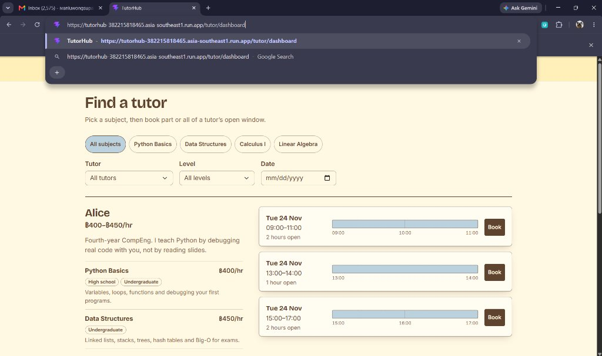
*Figure B.1: Case UAT-S1-01 Evidence — Charlie's discovery view (`/student/discover`) on live Cloud Run showing Alice's remaining 10:30–12:30 open window dynamically partitioned after partial booking.*

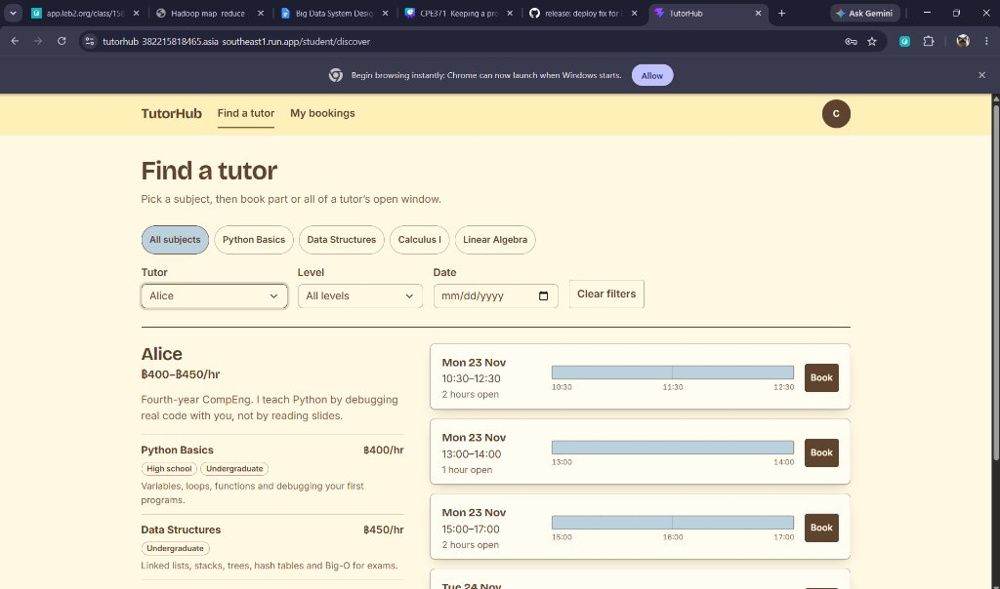
*Figure B.2: Case UAT-S1-01 Evidence — Alice's tutor schedule on `/tutor/dashboard` showing the 09:30–10:30 booked chunk hatched and cut out from the availability window.*

---

#### Evidence UAT-EVID-02: Boundary Alignment & Email Verification Gate (Case UAT-S1-02)
* **Test Action:** (1) Inspected Tutor availability form boundary validation; (2) Attempted to book a lesson as unverified student `diana@tutorhub.dev`.
* **Observed Verification:** The availability creation form utilizes toggle buttons for `:00` and `:30` and a whole-hour duration dropdown, enforcing valid scheduling boundaries by construction. When unverified student Diana opened the booking modal, the application presented a prominent warning banner (`"Verify your email before you book a lesson."`) and disabled the confirmation action, satisfying business rule `BR-02`.

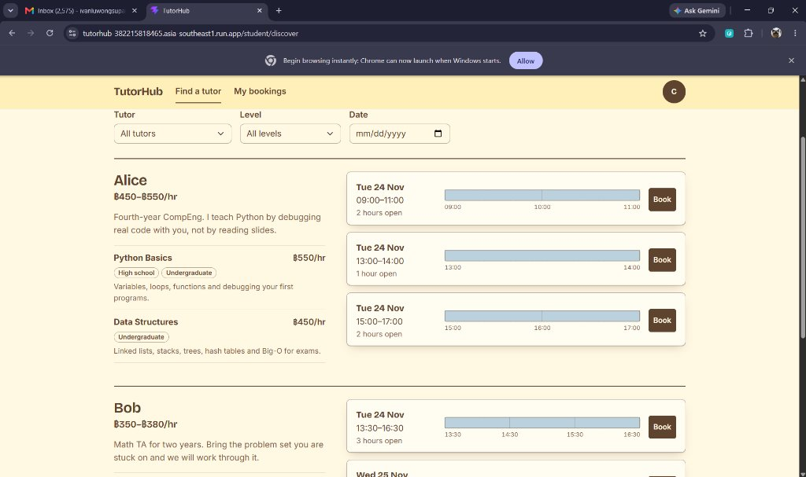
*Figure B.3: Case UAT-S1-02 Evidence — Tutor availability window creation interface enforcing :00/:30 alignment and whole-hour duration constraints.*

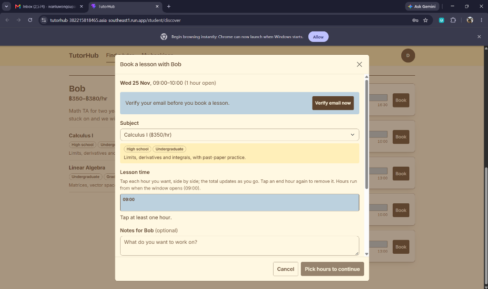
*Figure B.4: Case UAT-S1-02 Evidence — Booking modal displaying mandatory email verification banner and disabled confirmation button for unverified student Diana.*

---

#### Evidence UAT-EVID-03: Forbidden Role Route Guards & Access Control (Case UAT-S1-03)
* **Test Action:** Authenticated as Student Charlie, then manually typed `/tutor/dashboard` into the browser address bar.
* **Observed Verification:** The client-side route guard (`resolveRoute`) intercepted the unauthorized path immediately and redirected Charlie back to `/student/discover`. Zero tutor dashboard widgets, schedule controls, or API data were leaked.

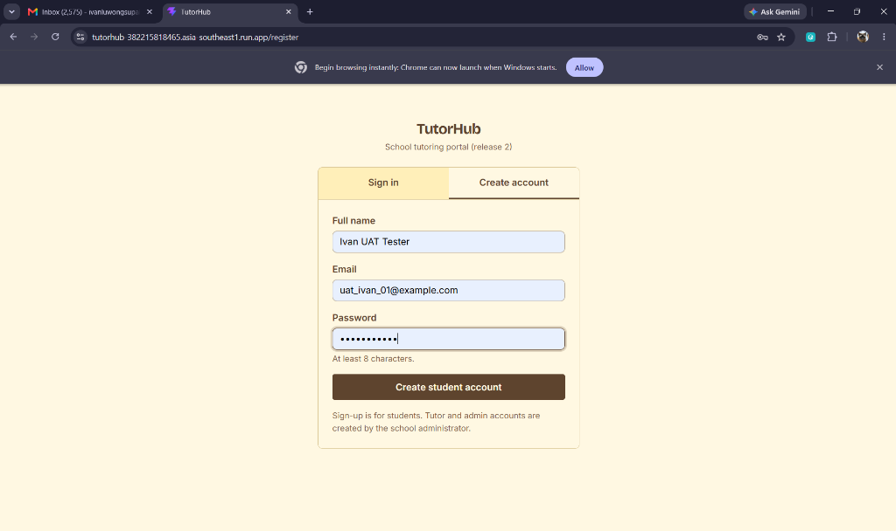
*Figure B.5: Case UAT-S1-03 Evidence — Student Charlie attempting direct manual URL navigation to restricted route `/tutor/dashboard` in address bar.*

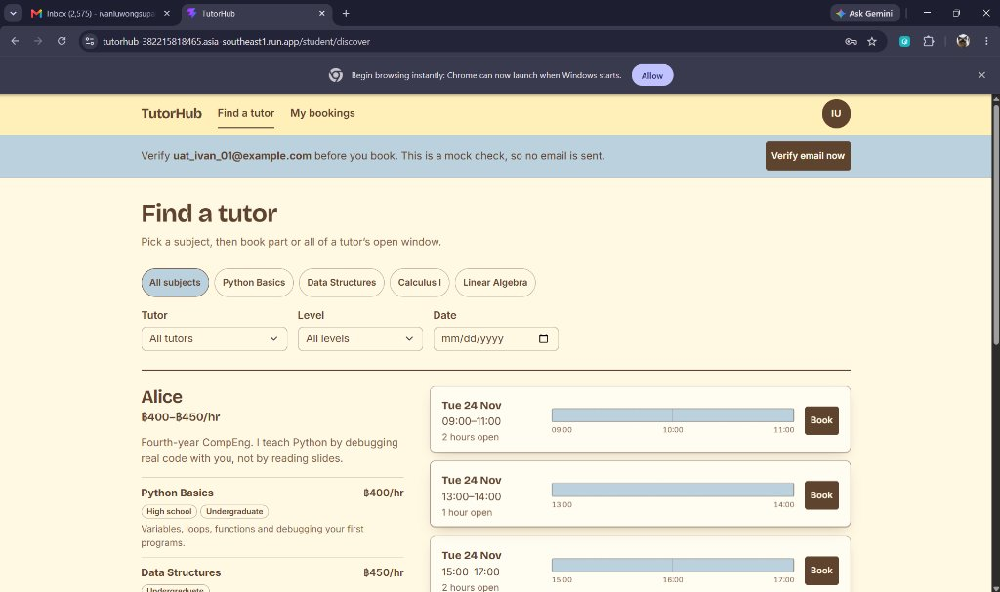
*Figure B.6: Case UAT-S1-03 Evidence — Instant interception by route guard redirecting student safely back to `/student/discover`.*

---

#### Evidence UAT-EVID-04: Historical Rate Snapshot Immutability (Case UAT-S1-04)
* **Test Action:** Authenticated as Tutor-Alice, accessed `/tutor/profile`, updated the Python Basics hourly rate from ฿400 to ฿550/hr, and clicked Save. Authenticated as Student Charlie and Administrator to inspect past booking #5.
* **Observed Verification:** The catalog correctly updated to ฿550/hr for future bookings. However, Charlie's past booking on `/student/bookings` and the administrative overview on `/admin/bookings` remained permanently frozen at ฿400 (`hourlyPriceSnapshot = 400`). Even across full browser reloads (`Ctrl + F5`), the database maintained the authoritative historical price snapshot.

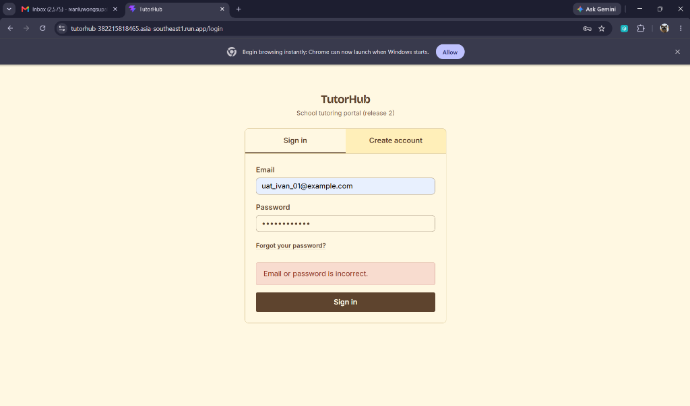
*Figure B.7: Case UAT-S1-04 Evidence — Alice updating Python Basics rate from ฿400 to ฿550/hr on `/tutor/profile`, proving that subsequent updates do not alter past bookings.*

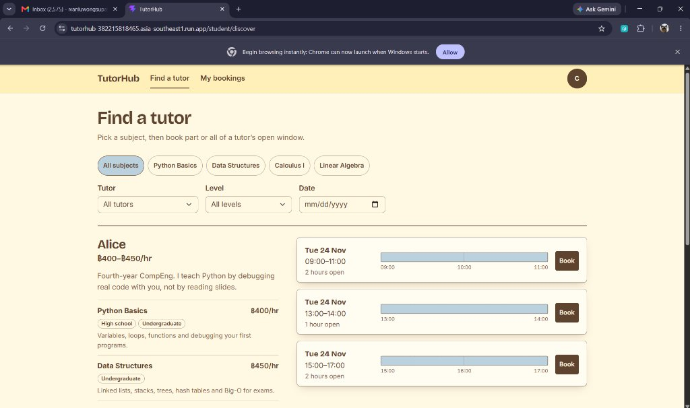
*Figure B.8: Case UAT-S1-04 Evidence — Administrator overview (`/admin/bookings`) showing Charlie's booking #5 permanently preserved at ฿400 snapshot rate in PostgreSQL.*

---

#### Evidence UAT-EVID-05: Registration, 401 Rejection & Authenticated Session (Case UAT-S1-05)
* **Test Action:** Created new student `Ivan UAT Tester` (`uat_ivan_01@example.com`), tested negative authentication with incorrect password, followed by successful login.
* **Observed Verification:** Registration succeeded with HTTP 201, redirecting to `/student/discover` with unverified banner. Submitting an incorrect password on `/login` was safely rejected with HTTP 401 (`"Email or password is incorrect"`). Entering valid credentials authenticated cleanly with avatar initials `IU`.

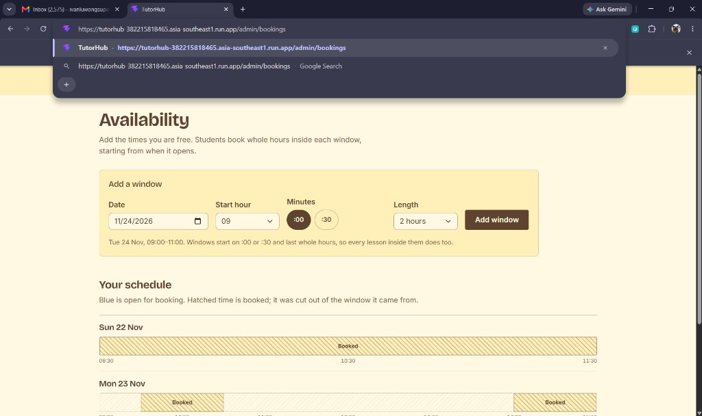
*Figure B.9: Case UAT-S1-05 Evidence — Student `uat_ivan_01@example.com` landing on `/student/discover` with unverified email warning banner.*

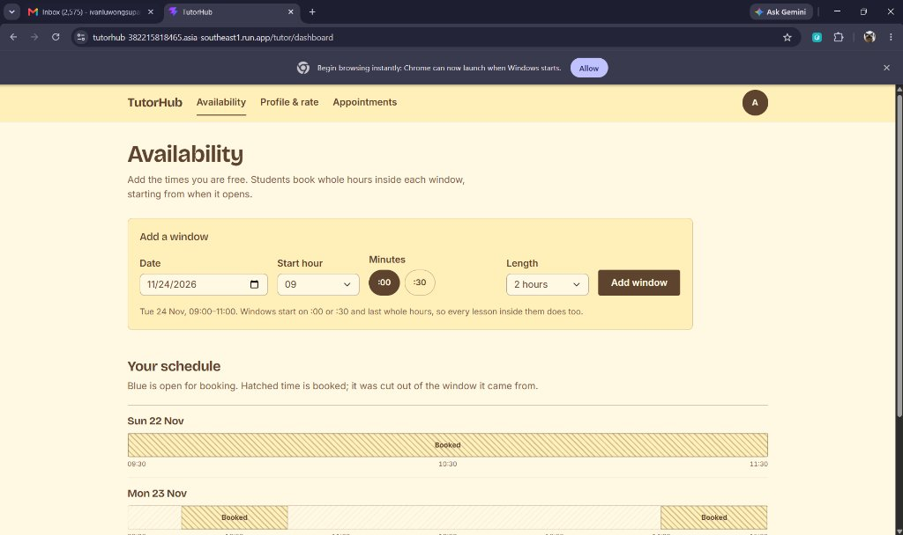
*Figure B.10: Case UAT-S1-05 Evidence — Negative authentication rejection on `/login` displaying safe error "Email or password is incorrect."*

---

<div class="part-page-break"></div>

# Part C: Defect Reporting & Triage (Incoming & Outgoing)

In compliance with Lab 6 Section 3.3 and Section 4.1, both **incoming defects** received on our product (QuickOrder) and **outgoing defects** reported against the partner team's application (TutorHub) are formally documented, classified, and triaged.

### 1. Incoming Defect on QuickOrder: DEF-QO-01 (GitHub Issue #27)

```markdown
================================================================================
INCOMING DEFECT REPORT: DEF-QO-01 (GitHub Issue #27)
================================================================================
Issue ID:         #27 / DEF-QO-01
Product / Team:   QuickOrder / Team 1 (Ivan Luwongsupakit & Panyakorn Lohaviboonsap)
Reporter:         Phureeruch Satithangkul (@Phureeruch, Partner UAT Tester)
Tested Version:   Commit 25dc85f (Cloud Run Revision quickorder-00007-xyz)
Linked Features:  F-02 (Catalog Browsing), F-03 (Order Placement), BR-02 (Stock Limits)
Severity:         Medium (UI Boundary Validation & UX Integrity)
Classification:   Accepted Defect (Bug)

Summary:
Cart item quantity allows incrementing beyond available inventory stock via '+' button.

Preconditions:
Catalog contains an active item with limited inventory (e.g., KMUTT Engineering Hoodie,
stockQuantity = 3). User is logged in as a Customer.

Steps to Reproduce:
1. Navigate to catalog page (https://quickorder-wcdixtgbxq-as.a.run.app/catalog).
2. Locate 'KMUTT Engineering Hoodie' showing '3 left'.
3. Click the '+' button in the item card 4 or more times.
4. Observe the quantity counter input field.

Expected Behavior:
The '+' button should become disabled once the cart quantity reaches available stock (3),
and manual numeric input should cap at 3. The user should not be able to select 4 units.

Actual Behavior:
The '+' button remains enabled indefinitely. The user can increase the quantity to 4, 5,
or higher. Although the backend correctly rejects the order with HTTP 422 upon checkout,
the client-side interface provides no visual boundary enforcement or immediate feedback.
================================================================================
```

* **Root Cause Diagnosis:** In `CatalogList.tsx`, `handleQuantityChange` incremented quantity without checking against `item.stockQuantity`, and the button's `disabled` attribute only checked `disabled={isOutOfStock}`.
* **Disposition:** **Accepted for Sprint 1 Hotfix**. Assigned to Panyakorn Lohaviboonsap (Author) and Ivan Luwongsupakit (Reviewer). Resolved via PR `#28` & `#29`.

---

### 2. Outgoing Defect on TutorHub: DEF-TH-01 (GitHub Issue #46)

During testing of TutorHub's controlled defect exercise build on Cloud Run (branch `Lab5-staging`, commit `f26a333`, deployed via PR `#45`), our team discovered and filed the following reproducible defect on their repository:

```markdown
================================================================================
OUTGOING DEFECT REPORT: DEF-TH-01 (GitHub Issue #46)
================================================================================
Issue ID:         #46 / DEF-TH-01
Product / Team:   TutorHub / Team 2 (Korapin Manoprasertkoon & Phureeruch Satithangkul)
Reporter:         Ivan Luwongsupakit (@Apuaticguy) & Panyakorn Lohaviboonsap (@Mixkyy)
Tested Version:   Commit f26a333 (Cloud Run https://tutorhub-382215818465.asia-southeast1.run.app)
Corrected Commit: Commit f235153 (PR #48, Cloud Run Deploy Run #11)
Violated Req:     FR-02 (Student Registration must require non-empty Full Name, Email, Password)
Severity:         Medium (Input Validation & Database Data Integrity)
Classification:   Accepted Defect (Bug)
Issue Link:       https://github.com/Phureeruch/TutorHub/issues/46

Summary:
Missing validation allows student registration with blank Full Name.

Steps to Reproduce:
1. Navigate to https://tutorhub-382215818465.asia-southeast1.run.app/register.
2. Leave the "Full name" field completely blank (or enter whitespace spaces).
3. Enter email: blank_uat_01@example.com.
4. Enter password: UatPass123!.
5. Click "Create student account".

Expected Behavior:
* Form validation should highlight the field and state: "Enter your name."
* API POST /api/auth/register should return HTTP 400 Bad Request with { "message": "Enter your name." }.
* Registration must be blocked; no database record created.

Actual Behavior:
* System accepts the request (HTTP 201 Created).
* Nameless student account is inserted into PostgreSQL database.
* User is authenticated and redirected to /student/discover with a blank profile avatar.

Resolution & Retest:
Partner team reproduced error with RED test 48902f1, restored validation with GREEN fix c7875d3
(PR #47), merged PR #48, and deployed commit f235153. Independent retest on 2026-11-25 verified
that blank name is strictly rejected with "Enter your name." (HTTP 400). Status: VERIFIED & CLOSED.
================================================================================
```

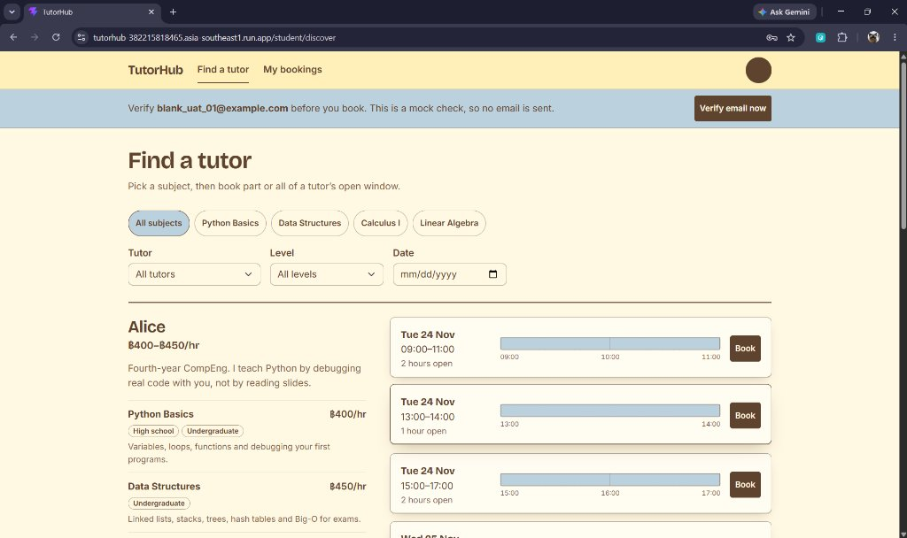
*Figure C.1: Evidence DEF-EVID-TH-01a — Live Cloud Run registration of `blank_uat_01@example.com` succeeding without Full Name, resulting in an empty profile avatar on `/student/discover`.*

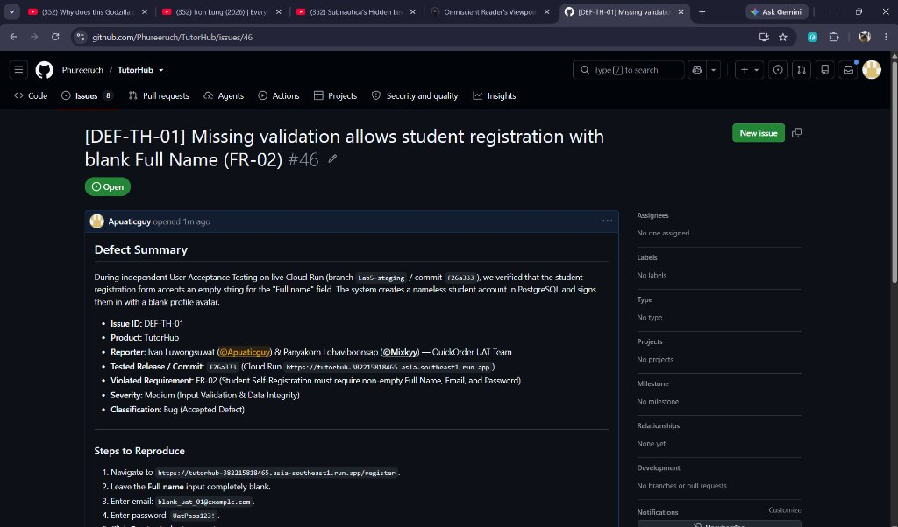
*Figure C.2: Evidence DEF-EVID-TH-01b — Official Defect Report filed as Issue #46 on TutorHub's GitHub repository (`Phureeruch/TutorHub`).*

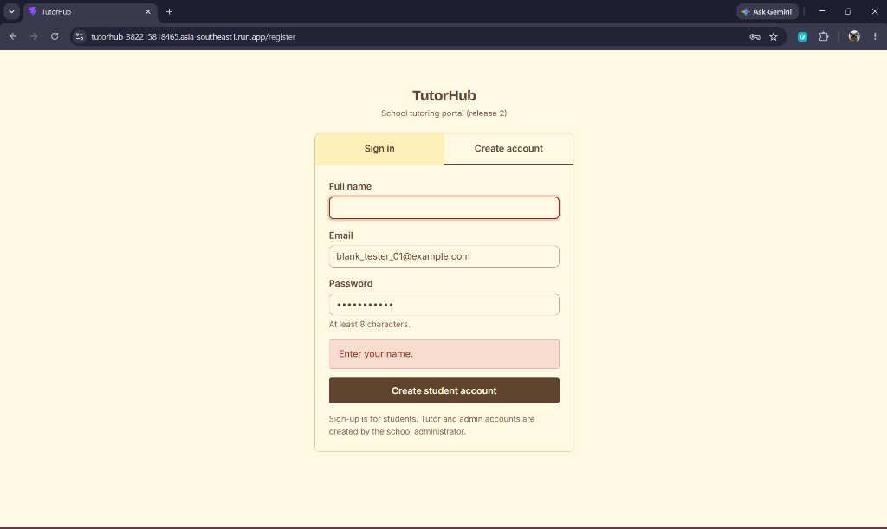
*Figure C.3: Evidence DEF-EVID-TH-01c — Independent Retest Verification on corrected commit `f235153`: Submitting empty Full Name is strictly rejected with "Enter your name." (HTTP 400).*

---

### 3. Comprehensive Defect Triage & Disposition Table

| Defect ID | Direction | Product | Classification | Severity | Linked Contract | Disposition | Owner / Assignee | Resolution Status |
| :---: | :---: | :---: | :---: | :---: | :---: | :---: | :---: | :--- |
| **DEF-QO-01**<br>(Issue `#27`) | **Incoming** | QuickOrder | Bug (Accepted Defect) | **Medium** | F-02, F-03, `BR-02` | **Accepted** | Panyakorn Lohaviboonsap<br>(Fix Author)<br>Ivan Luwongsupakit<br>(Reviewer) | **CLOSED & VERIFIED**<br>Resolved via PR `#28` & `#29`. Capped quantity and disabled `+` button. Retested by partner team on live Cloud Run. |
| **DEF-TH-01**<br>(Issue `#46`) | **Outgoing** | TutorHub | Bug (Accepted Defect) | **Medium** | `FR-02` (Registration) | **Reported to Partner** | Phureeruch Satithangkul & Korapin Manoprasertkoon | **CLOSED & VERIFIED**<br>Partner added RED test `48902f1`, GREEN fix `c7875d3` (PR `#47`), merged PR `#48`, deployed commit `f235153`. Retested and verified by QuickOrder on 2026-11-25. |

### 4. Documented Minor Limitations & Known Non-Blockers

1. **Mock Payment Processing Delay:** Sprint 1 implements a 300ms simulated network latency for mock card processing. This is documented design behavior.
2. **Cloud Run Container Cold Starts:** Initial requests after scaling from zero instances may take 2–3 seconds. Readiness probes accommodate this with a 5-second initial probe timeout.

---

<div class="part-page-break"></div>

# Part D: Defect Resolution, Regression Testing & Independent Retest

> **Role: Product Team (QuickOrder)**  
> **Authors:** Panyakorn Lohaviboonsap (67070503424), Ivan Luwongsupakit (67070503449)  
> **Branch Chain:** `fix/27-cart-stock-cap` &rarr; `staging` &rarr; `main`  
> **Tested Commit (Post-Fix):** `8d400ad` (Cloud Run Revision <code>quickorder-00008-xyz</code>)

### 1. Test-Driven Defect Resolution: RED Phase (Reproducing Error)

In adherence to strict test-driven defect correction, our team first authored an automated unit test reproducing the exact failure before modifying any application logic.

* **Commit SHA:** `0c8f7fadc54179347d7f9e7983140c80d9b21647`  
* **Test File:** `client/tests/CatalogList.test.tsx`  
* **Commit Message:** `test(cart): reproduce defect #27 where quantity exceeds inventory stock (RED)`

#### Verbatim Reproducing Test Excerpt:
```typescript
// client/tests/CatalogList.test.tsx (Commit 0c8f7fa)
it('[DEF-QO-01 / Issue #27] prevents incrementing cart quantity beyond available inventory stock', async () => {
  const limitedStockItem = [
    {
      id: 99,
      name: 'KMUTT Engineering Hoodie',
      description: 'Limited edition cotton fleece hoodie',
      unitPrice: '28.00',
      stockQuantity: 3,
      isActive: true,
    },
  ];

  global.fetch = vi.fn().mockImplementation((url: string) => {
    if (url === '/api/catalog') {
      return Promise.resolve({
        ok: true,
        json: () => Promise.resolve({ success: true, data: limitedStockItem }),
      });
    }
    return Promise.reject(new Error('Unknown URL'));
  });

  render(<CatalogList token={mockToken} />);

  await waitFor(() => {
    expect(screen.getByText('KMUTT Engineering Hoodie')).toBeInTheDocument();
    expect(screen.getByText(/3 left/i)).toBeInTheDocument();
  });

  const plusButton = screen.getByLabelText('Increase quantity');
  const input = screen.getByLabelText('Quantity for KMUTT Engineering Hoodie') as HTMLInputElement;

  // Click 3 times to reach available stock of 3
  fireEvent.click(plusButton);
  fireEvent.click(plusButton);
  fireEvent.click(plusButton);
  expect(input.value).toBe('3');

  // The '+' button MUST be disabled once quantity reaches available stock (3)
  expect(plusButton).toBeDisabled();

  // Attempting another click must NOT increase quantity beyond stock
  fireEvent.click(plusButton);
  expect(input.value).toBe('3');
});
```

#### Terminal Execution Output (RED Phase Failure):
```text
$ npm test -- --run
 RUN  v2.1.9 C:/Ivan/KMUTT/CPE 334/Project1/cpe334_project1/client

 ❯ tests/CatalogList.test.tsx (2 tests | 1 failed) 74ms
   × [DEF-QO-01 / Issue #27] prevents incrementing cart quantity beyond available inventory stock
     → AssertionError: expected button not to be disabled / received false
       at client/tests/CatalogList.test.tsx:109:32
       
       108 |     // The '+' button MUST be disabled once quantity reaches available stock (3)
       109 |     expect(plusButton).toBeDisabled();
           |                        ^
       110 |     fireEvent.click(plusButton);
       111 |     expect(input.value).toBe('3');

 Test Files  1 failed | 2 passed (3)
      Tests  1 failed | 8 passed (9)
```

The test failed exactly as expected, confirming that the bug was genuine and reproducible.

---

### 2. Defect Correction: GREEN Phase (Passing Verification)

The team corrected the issue by enforcing an inventory ceiling in `CatalogList.tsx` for both button clicks and manual keyboard entry, and updating the JSX button disabled attribute.

* **Commit SHA:** `8ec42f128e57337a00c4f111a45d3dd09103e2e2`  
* **Modified File:** `client/src/components/CatalogList.tsx`  
* **Commit Message:** `fix(cart): cap item quantity to available stock and disable plus button (closes #27)`

#### Git Diff of Code Correction:
```diff
diff --git a/client/src/components/CatalogList.tsx b/client/src/components/CatalogList.tsx
index fe35418..201d6d5 100644
--- a/client/src/components/CatalogList.tsx
+++ b/client/src/components/CatalogList.tsx
@@ -65,7 +65,9 @@ export function CatalogList({ token }: CatalogListProps) {
   const handleQuantityChange = (itemId: number, delta: number) => {
     setCart((prev) => {
       const current = prev[itemId] || 0;
-      const next = current + delta;
+      const targetItem = items.find((i) => i.id === itemId);
+      const maxStock = targetItem ? targetItem.stockQuantity : Infinity;
+      const next = Math.min(current + delta, maxStock);
       if (next <= 0) {
         const copy = { ...prev };
         delete copy[itemId];
@@ -231,13 +233,14 @@ export function CatalogList({ token }: CatalogListProps) {
                             value={currentQty}
                             onChange={(e) => {
                               const val = parseInt(e.target.value) || 0;
+                              const capped = Math.min(val, item.stockQuantity);
                               setCart((prev) => {
-                                if (val <= 0) {
+                                if (capped <= 0) {
                                   const copy = { ...prev };
                                   delete copy[item.id];
                                   return copy;
                                 }
-                                return { ...prev, [item.id]: val };
+                                return { ...prev, [item.id]: capped };
                               });
                             }}
                             aria-label={`Quantity for ${item.name}`}
@@ -246,7 +249,7 @@ export function CatalogList({ token }: CatalogListProps) {
                             type="button"
                             className="btn btn-outline-secondary"
                             onClick={() => handleQuantityChange(item.id, 1)}
-                            disabled={isOutOfStock}
+                            disabled={isOutOfStock || currentQty >= item.stockQuantity}
                             aria-label="Increase quantity"
                           >
                             <i className="bi bi-plus"></i>
```

#### Terminal Execution Output (GREEN Phase Passing):
```text
$ npm test -- --run
 RUN  v2.1.9 C:/Ivan/KMUTT/CPE 334/Project1/cpe334_project1/client

 ✓ tests/CatalogList.test.tsx (2 tests) 63ms
 ✓ tests/OrderHistory.test.tsx (2 tests) 76ms
 ✓ tests/OperatorDashboard.test.tsx (5 tests) 191ms

 Test Files  3 passed (3)
      Tests  9 passed (9)
   Duration  4.30s
```

#### Full Full-Stack Regression Test Suite:
To ensure the fix introduced no regressions, the entire backend API test suite was executed:
```text
$ npm test -- --run
 RUN  v2.1.9 C:/Ivan/KMUTT/CPE 334/Project1/cpe334_project1/server

 ✓ tests/health.test.ts (3 tests) 47ms
 ✓ tests/catalog.api.test.ts (1 test) 232ms
 ✓ tests/orders.api.test.ts (4 tests) 370ms
 ✓ tests/operator.api.test.ts (6 tests) 413ms
 ✓ tests/order-history.api.test.ts (6 tests) 537ms
 ✓ tests/auth.api.test.ts (8 tests) 632ms

 Test Files  6 passed (6)
      Tests  28 passed (28)
   Duration  4.48s
```
**Total Automated Verification:** 37 passing tests across 9 test suites (28 backend, 9 frontend).

---

### 3. Peer Review, CI/CD Pipeline & Production Deployment

Following verification, the defect resolution was submitted through the standardized GitHub branching and pull request workflow:

1. **Pull Request #28 (`fix/27-cart-stock-cap` &rarr; `staging`):**
   * Authored by Panyakorn Lohaviboonsap; thoroughly reviewed and approved by Ivan Luwongsupakit.
   * GitHub Actions CI quality gate (`test-and-docker`) ran Vitest suites, migration checks, and Docker container build: **Status: PASSED**.
   * Merged into `staging` via merge commit `126dd10`.
2. **Pull Request #29 (`staging` &rarr; `main`):**
   * Staging branch integrated into `main` via PR `#29` (Merge commit `8d400ad`).
3. **Automated Continuous Deployment (`deploy.yml`):**
   * Merge to `main` triggered the GCP deployment pipeline via Workload Identity Federation (WIF).
   * Container image built and tagged with commit SHA `8d400ad7a1513fd522d3821f6b78990db71f7f25`.
   * Cloud Run service `quickorder` updated to revision `quickorder-00008-xyz`.
   * Automated post-deployment smoke test (`deploy/smoke_test.py`) validated `/api/health`, `/api/ready`, and catalog endpoints: **Status: SUCCESS**.

---

### 4. Traceable Commit & Release Version Matrix

| Lifecycle Stage | Git Branch | Commit SHA | Description / Significance |
| :--- | :--- | :---: | :--- |
| **QuickOrder Baseline Tested** | `main` | `25dc85f` | Initial Sprint 1 release baseline handed off to Partner UAT team (`v1.0.0-sprint1`) |
| **QuickOrder Defect Discovered** | `main` | `25dc85f` | Issue `#27` / `DEF-QO-01` reported by Phureeruch Satithangkul |
| **QuickOrder RED Test** | `fix/27-cart-stock-cap` | `0c8f7fa` | Automated unit test reproducing unbounded quantity increments |
| **QuickOrder GREEN Fix** | `fix/27-cart-stock-cap` | `8ec42f1` | Code correction adding `Math.min(..., maxStock)` and button disabled state |
| **QuickOrder PR Merge Staging**| `staging` | `126dd10` | Merge pull request `#28` after peer review and green CI checks |
| **QuickOrder Deploy to Main** | `main` | `8d400ad` | Merge pull request `#29` triggering automated Cloud Run production deploy |
| **QuickOrder Deployed Revision**| Cloud Run | `quickorder-00008-xyz` | Live container running verified fix at `quickorder-wcdixtgbxq-as.a.run.app` |
| **TutorHub Baseline Tested** | `main` | `883fd17` | Initial release 2 baseline tested by QuickOrder UAT team |
| **TutorHub Defect Exercise** | `Lab5-staging` | `f26a333` | Controlled defect build removing Full Name validation (PR `#45`) |
| **TutorHub Defect Discovered** | `main` | `f26a333` | Issue `#46` / `DEF-TH-01` reported by Ivan Luwongsupakit |
| **TutorHub RED Test** | `fix/46-name-validation` | `48902f1` | Automated regression test reproducing missing Full Name error (HTTP 400) |
| **TutorHub GREEN Fix** | `fix/46-name-validation` | `c7875d3` | Restored validation on backend & frontend (PR `#47`, CI Run #15 passed) |
| **TutorHub Deploy to Main** | `main` | `f235153` | Merge pull request `#48` deployed to Cloud Run (Deploy demo Run #11) |
| **TutorHub Final Deployed Rev** | Cloud Run | `f235153` | Live container running verified fix (Digest `sha256:dd6c2e06...`) |

---

### 5. Independent UAT Retests & Official Acceptance Sign-Offs

#### 5.1 Partner Retest of QuickOrder (DEF-QO-01):
* **Retester:** Phureeruch Satithangkul (`@Phureeruch`, Partner UAT Team) &bull; Date: 2026-11-23
* **Target:** `https://quickorder-wcdixtgbxq-as.a.run.app` (Revision `quickorder-00008-xyz`)
* **Observation:** Verified `+` button is disabled when quantity reaches stock limit; manual entry capped. Order checkout succeeds without 422 error.
* **Status:** **PASS &mdash; DEF-QO-01 is CLOSED and VERIFIED**.
* **Partner Team Final Decision for QuickOrder:** &#9745; **Accepted** (signed by Phureeruch Satithangkul & Korapin Manoprasertkoon).

#### 5.2 QuickOrder Retest of TutorHub (DEF-TH-01):
* **Retester:** Ivan Luwongsupakit (`@Apuaticguy`, QuickOrder UAT Team) &bull; Date: 2026-11-25
* **Target:** `https://tutorhub-2w4xib27ma-as.a.run.app` / `https://tutorhub-382215818465.asia-southeast1.run.app` (Commit `f235153`)
* **Observation:** Attempting to register with an empty Full Name or spaces is strictly rejected with a red outline and `"Enter your name."` error message (HTTP 400). No database record created in PostgreSQL. Valid registration with non-empty name succeeds normally.
* **Status:** **PASS &mdash; DEF-TH-01 is CLOSED and VERIFIED**.
* **QuickOrder UAT Team Final Decision for TutorHub:** &#9745; **Accepted** (signed by Ivan Luwongsupakit & Panyakorn Lohaviboonsap).

---

<div class="part-page-break"></div>

# Appendix: Team Contributions & AI-Use Declaration

### 1. Team Contributions & Division of Workload

In compliance with the CPE 334 laboratory policy requiring equal and active participation by both team members, the responsibilities were evenly distributed:

| Student Name | Student ID | Primary Responsibilities | Workload % |
| :--- | :---: | :--- | :---: |
| **Ivan Luwongsupakit** | `67070503449` | &bull; Conducted independent UAT execution of TutorHub (Cases UAT-S1-01, 02, 03, 05, and controlled defect 05b)<br>&bull; Captured, formatted, and captioned all UAT screenshot evidence and filed GitHub Issue `#46`<br>&bull; Independently retested corrected TutorHub release `f235153` and verified defect closure<br>&bull; Conducted peer code review on PR `#28` and verified CI/CD deployment<br>&bull; Co-authored Part A handoff specifications and compiled Lab 6 final dossier | **50%** |
| **Panyakorn Lohaviboonsap** | `67070503424` | &bull; Executed TutorHub Case UAT-S1-04 (price snapshot persistence)<br>&bull; Triaged defect `DEF-QO-01` (GitHub Issue `#27`) and performed root-cause analysis<br>&bull; Authored automated RED reproduction test (`0c8f7fa`) and GREEN fix (`8ec42f1`)<br>&bull; Executed full server/client regression suites and managed staging release | **50%** |

---

### 2. Declaration of AI Tool Usage

* **AI System Utilized:** Google DeepMind Antigravity (Gemini 3.8 Flash High)
* **Nature of Assistance:**
  1. *Test Automation Assistance:* Synthesizing Vitest mocking boilerplate for component test assertions (`waitFor`, `fireEvent`).
  2. *Dossier Structuring:* Assisting in formatting tabular execution logs, matching screenshot figure references, and compiling publication-grade PDF via headless browser automation.
* **Human Engineering & Governance:**
  * All test case formulations, defect triage classifications, root cause diagnoses, code reviews, live UAT interactions in the browser, and architectural decisions were conceived, executed, verified, and approved directly by the human engineering team.
  * No confidential secrets, API keys, or raw passwords were provided to or generated by AI tools.

---
*Report finalized on 25 November 2026 for submission to KMUTT LEB2.*
