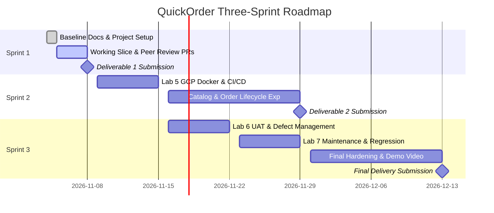

# Three-Sprint Development Plan - QuickOrder

**Project:** QuickOrder (Theme 4: E-Commerce or Ordering System)  
**Authors:** Panyakorn Lohaviboonsap (67070503424), Ivan (Apuaticguy)  
**Status:** Baseline Draft  

---

## 1. Overview and Milestones

The product engineering journey is structured across three continuous sprints, taking QuickOrder from an initial vertical slice to a fully hardened, containerized, and UAT-verified cloud release.

---

## 2. Sprint-by-Sprint Breakdown

### Sprint 1: Small Working Domain Slice with Authentication & Permissions
* **Deadline:** 8 November 2026 at 23:59 (Project Deliverable 1 - 80 points)
* **Goal:** Prove the foundational architecture and engineering discipline with a small, useful, fully tested vertical slice.
* **Included Features:**
  - `F-01`: User Authentication, Role Authorization, and Security Middlewares (`CUSTOMER`, `OPERATOR`).
  - `F-02`: Catalog Browsing and Live Item Availability.
  - `F-03`: Authoritative Server-Side Order Placement, Unit Price Calculation, and Stock Validation.
  - `F-04`: Customer Order History and Persisted Line-Item Breakdown with Ownership Guards.
  - `F-05`: Operator Incoming Order Queue and Order State Acceptance (`SUBMITTED` $\rightarrow$ `ACCEPTED`).
* **Dependencies:**
  - `F-01` provides user identities and role guards for all features.
  - `F-02` seeds catalog items needed by `F-03`.
  - `F-03` produces order records consumed by `F-04` and `F-05`.
* **Completion Outcome:**
  - Fully runnable application locally on `main` with verified `README.md` setup instructions.
  - Automated test suites (Vitest + Supertest) passing 100% on `main`.
  - Git history demonstrating 4 peer-reviewed PRs into `sprint1-staging` and a merged release PR to `main`.
  - Deliverable 1 PDF report covering Parts A–F submitted through LEB2.

---

### Sprint 2: Core Expansion & Cloud Delivery Pipeline
* **Deadline:** 29 November 2026 at 23:59 (Project Deliverable 2 - 70 points & Lab 5 - 100 points)
* **Goal:** Expand core catalog management, order cancellation lifecycle, simulated payments, and establish automated Docker/GCP deployment.
* **Included Features:**
  - `F-06`: Catalog & Inventory Administration (Operator creates/updates items, changes prices, manages stock).
  - `F-07`: Order Cancellation & Rejection Workflow (Customer cancels before acceptance; Operator rejects with reason).
  - `F-08`: Simulated Payment Processing (`UNPAID` $\rightarrow$ `PAID` $\rightarrow$ `REFUNDED` status lifecycle).
  - Lab 5 Scope: Docker containerization, GitHub Actions CI/CD quality gate, and Google Cloud Run deployment.
* **Dependencies:**
  - Depends on stable Sprint 1 data models and authentication baseline.
* **Completion Outcome:**
  - Integrated release candidate deployed live on Google Cloud Platform.
  - Passing automated CI pipeline blocking broken PRs.
  - Deliverable 2 report with updated contracts and traceability matrix.

---

### Sprint 3: Completion, UAT Verification & Final Hardening
* **Deadline:** 13 December 2026 at 23:59 (Final Delivery - 100 points & Labs 6 & 7)
* **Goal:** Complete fulfillment workflows, analytics reporting, external UAT defect correction, maintenance change, and final demo.
* **Included Features:**
  - `F-09`: Order Fulfillment & Ready-for-Pickup Status Management.
  - `F-10`: Sales Analytics & Revenue Reporting Dashboard for Operators.
  - `F-11`: Favorite Orders & Quick Re-Order for Customers.
  - Lab 6 Scope: Cross-team UAT testing, defect triage, regression test creation, and bug fixes.
  - Lab 7 Scope: Approved maintenance change impact analysis and TDD regression-safe release.
* **Dependencies:**
  - Built on top of Sprints 1 and 2 deployed increments.
* **Completion Outcome:**
  - Complete, robust, verified application running in production.
  - Final QA sign-off and Definition of Done audit.
  - Maximum 10-minute team video demonstrating core domain journeys, business rule rejections, and architecture.
